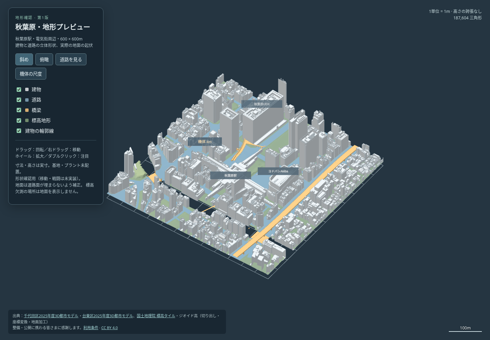

# 秋葉原のPLATEAU地形プレビュー

ユーザー指定（2026-10-22）：梅田の収録状況を確認し、赤レンガ倉庫を候補にし、難しければ秋葉原。建物モデルに加えて地上の道路・橋梁を取り込める秋葉原で、地形確認用のプレビューを作成した。[候補地の調査](../../research/maps/plateau-candidates/README.md) に収録状況と採用判断を残す。

[単体HTMLの3Dプレビュー](preview.html) を保存してブラウザで開ける。外部通信は不要。基地・プラントは未配置で、[地形→基地→プラント→Bot対戦の手順](../WORKFLOW.md) の最初の確認段階。

ユーザー指定の大胆な単純化と細い隙間の整理は、別の[簡略化案](compact/README.md)に保存した。[簡略化版3D](compact/preview.html) / [塞いだ隙間の俯瞰図](compact/infill.png)。元の形状との比較用に、このフォルダの初版は保持する。



[俯瞰図](top.png) / [建物を隠した道路・橋梁](street.png)

## 範囲と形状

- 秋葉原駅・電気街・神田川付近の600×600m。中心は東経139.7734度・北緯35.6986度、回転0度、俯瞰図の上が北。秋葉原駅・秋葉原UDX・ヨドバシAkibaのラベルは位置を確認するための目安で、モデル属性の正式な建物IDとの結合ではない。
- 東京都・千代田区2025年度モデルと台東区2025年度モデルを併用。最詳細の建物31・道路19・橋梁2の計52タイル／56メッシュを復号した。建物LOD2（テクスチャなし）、道路LOD3、橋梁LOD2。配信年度が2025であり、全地物が2025年に測量されたという意味ではない。
- 国土地理院5m DEM（レーザ）`dem5a_png`、ズーム15の1タイルを4m格子へ補間。元標高の有限値は約-0.37〜11.83m。中心標高5.7mを表示の0、中心ジオイド高36.8651mを局所的な一定値として楕円体高から標高へ合わせる。高さを誇張しない。
- 標高欠測は1,322格子点。欠測に触れる地面の三角形は出力せず、地形を推測して埋めない。神田川付近の暗い空白は地面を表示していない場所で、水面・河床・護岸を完成させた表示ではない。川の水面は未作成。
- DEMが道路を覆わないよう、地面だけを道路面の0.35m下へ下げ、4m格子の補間用に周囲1格子へ広げる。最大下げ幅は約6.55m。道路・橋梁の実メッシュは変えず上下に残す。この地面は表示用の加工物で、測量成果としての利用を想定しない。
- 地形は187,604三角形。外周±300mで三角形を切り、切断面に蓋を付けていない。屋根形状を箱へ置き換えない。確認用の4m機体は独自の簡略形状で、道路上に配置した。

左ドラッグで回転、右ドラッグまたはShift＋ドラッグで移動、ホイールで拡大、ダブルクリックで注目。俯瞰・斜め・道路・機体の尺度の4視点と、建物・道路・橋梁・標高地形の表示切替を持つ。スマートフォンは「表示設定」でパネルを開閉する。

## 検証と未実装の部分

[形状検査](geometry-check.json)、[ブラウザ検査](browser-check.json)、[既存プレビューとの比較](regression-check.json)、[集計](summary.json) を保存した。

- b3dm内のglTFと、台東区の直接配信GLBの双方を復号。glTFのnode平行移動とECEFのRTC中心を区別し、全56メッシュを公開contentの緯度・経度・楕円体高の範囲へ照合した。高さの範囲外差は最大約0.035m（検査許容0.2m）。これはデータの測量精度を保証する値ではない。
- ファイル名が同じで配信パスが異なるGLBは、URIのハッシュをファイル名に含めて衝突を防ぐ。取得元URL・バイト数・SHA-256を [source-manifest.json](source-manifest.json) へ保存し、組み立て前に照合する。
- 出力面は有限値・水平±300m以内。DEMの欠測は面を省略し、有限値の標高と道路下方補正を検査した。
- Chromiumをオフラインにして起動。4視点・4地物の切替、回転・拡大・平行移動、390×844表示を確認。比較機体の高さ4mと、機体が建物に遮られず見えることも検査。外部通信0、ブラウザエラー0。
- 既存の都庁プレビューは変換前の作業キャッシュと形状・標高の全7配列が完全一致し、同じオフライン表示検査も通過した。既存の生成済みHTMLと画像は変更しない。
- ゲーム本体や既存マップは変更しない。衝突、機体の通行、地下、鉄道の連続した走行床、川の処理、屋根への到達、Bot経路と公平さは未検証。[知識台帳](../LESSONS.md) M01/M02/M28に沿って、表示できたことと通行できることを区別する。基地・プラント配置、Bot戦、ゲーム配布ZIP作成は行わない。

## 再生成

Python・Draco・Playwrightの準備は [都庁プレビューの手順](../plateau_city/README.md#再生成) と同じ。サイト設定を指定して取得する。

```sh
python3 tools/plateau/fetch.py /tmp/akihabara-cache --config research/maps/akihabara-sources.json
PLATEAU_DRACO_MODULE=/tmp/plateau-deps/node_modules/draco3d node tools/plateau/decode.cjs /tmp/akihabara-cache
python3 tools/plateau/build.py /tmp/akihabara-cache /tmp/akihabara-preview
python3 tools/plateau/check.py /tmp/akihabara-cache /tmp/akihabara-preview
node tools/test/plateau_preview_check.cjs /tmp/akihabara-preview/preview.html
```

中心・範囲・出典が異なる場合は別のキャッシュを使う（混在は取得前に拒否する）。保存済みmanifestは当日の入力の記録で、公開側の更新があれば照合する。変換器は今回の座標方式・Draco圧縮・node平行移動を扱い、未知の回転・拡大縮小・入れ子node・ADDタイルは検査なしで取り込まない。

出力のHTML・検査結果・図をこのフォルダへ写す。生のモデル約25MB、復号中間ファイル、標高格子のnpzはコミットしない。出典・利用条件・謝辞は [CREDITS.md](CREDITS.md)。
