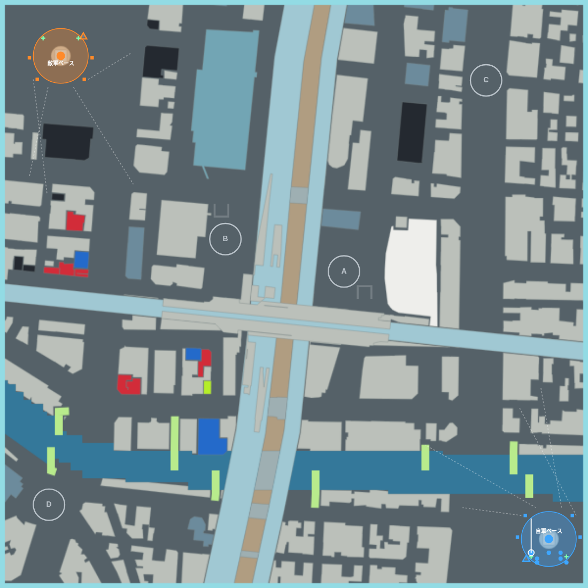
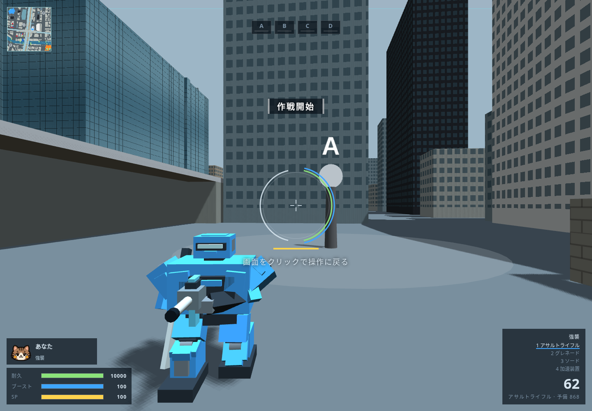

# 星路駅前・四街区争奪戦

2026-10-23、ユーザーが指定した赤丸4か所にプラントを置く対戦案。地形は初版から路地を残した再構築案を使い、基地位置と街路を引き継ぐ。10対10・10分、4プラントは中立から開始。中央2基と北東・南西の迂回路を争奪する。

各基地に左右2基ずつのカタパルト、防衛砲台4基、レーダー1基、リペアポッド2基を配置する。プラントにも補給ポッドを用意し、両軍それぞれの基地に最も近いプラントのポッドは5mの土手と2mの窪地で隠す。プラントからの再出撃は自軍の基地側の46〜52m、陸上に確保する。

橙側だけにあった高層棟用のジャンプパッドは、ユーザーの追加指定に従って対戦版から撤去した。両基地のカタパルトは同数で、中央プラントへ直接着地せず、基地外の街路へ展開する。

[対戦用の単体HTML](index.html)をChromium系ブラウザで開き、出撃側と装備を選んで出撃する。HTML内に本体・Three.js・音源・マップを同梱し、外部通信なしで動く。実体を持つ街と、本体の機体・射撃・占拠・撃破・コア・補給・カタパルト・Botを接続した試作。通常配信の本体と以前の試走版は変更しない。



## 配置

| プラント | 座標 x,z（m） | 赤丸の位置 |
| --- | --- | --- |
| A | 51, -23 | 中央東、白いランドマークの西側 |
| B | -70, -56 | 中央西、南北高架の西側 |
| C | 196, -218 | 北東の大きい道路 |
| D | -250, 215 | 南西の川沿い |

占拠半径16mは既存の空間に収まるため、プラントのために建物を削っていない。基地位置、18か所の配色、路地・駅・高架・川の8本の復帰路を引き継ぐ。A・Bのポッド周辺だけ、囲いと2mの窪地・幅8mの出入り坂を追加する。

10対10・上限10分・全プラント中立を今回の初期設定とした。プラントIDの順番は青基地からの距離順で、直線状の前線ではない。再出撃候補は両軍計66点。自基地を向いた半平面の46〜52m、地面が-2mの平坦な陸地で、川・孤立空間・建物・施設を避ける。

## 接続と容量

`build_battle.py` は共通の試走ビルダーから別のHTMLを作り、今回だけ対戦設備と20機の進行を有効にする。共通のゲーム本体へ新たな分岐やマップ形式を追加していない。`battle_plan.py` が街路を2m格子で分析し、細線化した経路と施設への接続を作る。実行時には都市の形状と本体の施設を組み立ててから、橋の下面・護岸の角など通れない辺を除き、主成分に連結した839節点・1,189辺を使う。Botの待機目標が建物内になる場合も近い街路へ移す。機体の速度・ブースト・重力・武器の数値は本体と共通。

| ファイル・内容 | 容量 |
| --- | ---: |
| 街の形状・必要な配置 `layout.json` | 66,525 B |
| 施設・経路・再出撃 `definition.json` | 30,687 B |
| 上記合計（非圧縮） | **97,212 B** |
| 上記をまとめたgzip | 41,501 B |
| 本体・音源等を含む単体HTML | 2,948,635 B |

100,000 Bの上限は圧縮前の街形状と対戦データの合計へ適用する。道路診断用の輪郭は承認済み版へ残し、実行時には重複して持たない。街のモデルは13,517三角形・206体積で、建物141体を維持する。これは本体の機体や追加施設の描画面数を含まない。

## 検査

M01/M02/M28/M31/M40を踏まえ、配置だけでなく本体の機体と処理を動かした。

- 軽量/重量機 × 30/120Hzでカタパルト8基を計32回射出。自動発射し、すべて指定地点から6m以内に着地。
- 両基地から全4プラントへの8経路をブースト・ジャンプなしで実走。全経路の辺も両方向に通行確認。
- 全4プラントを両軍で占拠し、各組24回、計192回の再出撃で距離・基地側・接地・障害物との重なりを確認。
- ポッド8基の修理・弾薬補給、補給中の発砲/ダッシュ/ジャンプ禁止、窪地から道路への徒歩脱出を確認。A・Bはそれぞれ敵側の地上11視点から遮蔽も検査。
- 防衛砲台8基が視認した敵を射撃し、両基地のレーダーが敵侵入を検知。
- 両陣営で出撃・実キー移動・Mの地図・Escの中断・再開を確認。[入力の記録](input-check.json)。
- 陣営・乱数を変えた20機のBot戦2試合で4地点すべての占拠、交戦・修理・再出撃・カタパルト・コア破壊と時間切れを確認。[コア破壊の記録](battle-check.json) / [時間切れの記録](battle-check-R-20261024.json)。GPU描画を省いた対戦進行の検査で、FPSの測定ではない。

初期の確認試合は286.45秒で南側コア破壊、撃破123回、占拠8回、射出台使用75回。2試合目は600秒で時間切れ、残コア1,856.25対868.5で南側勝利、撃破292回、占拠19回、射出台使用154回。勝率・先行占拠の差などの対戦バランスは、この動作確認だけでは評価しない。建物の高さによる迂回と両基地の非対称性は残っている。



## 再生成

Python依存は `tools/plateau/requirements-compact.txt`、Node.jsと同梱Three.js、検査にPlaywright/Chromiumを使う。新たな地理データ取得は不要。

```sh
python3 tools/plateau/build_battle.py mapdesign/akihabara_city/original_rebuilt /tmp/city-battle
node tools/test/city_battle_check.js /tmp/city-battle 600
node tools/test/city_battle_check.js /tmp/city-battle 600 20261024 R
node tools/test/city_battle_input_check.js /tmp/city-battle
```

入力設定は `research/maps/akihabara-battle.json`。入力形状と生成器のハッシュ・容量は [generation.json](generation.json)。別フォルダへ再生成したHTML・形状・対戦配置・生成記録のバイト一致、生成器10ファイルのハッシュ一致は [reproducibility.json](reproducibility.json)。出典と加工内容、謝辞は [CREDITS.md](CREDITS.md)。
