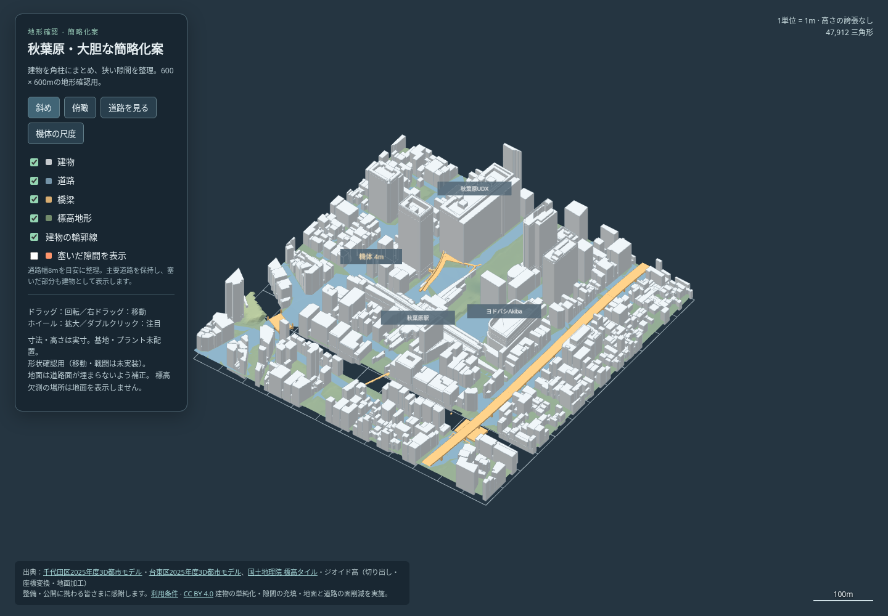

# 秋葉原・大胆な簡略化案

ユーザー指定（2026-10-22）「大胆に簡略化」「細い隙間で機体がスタックするのも嫌」に対応した地形確認案。[3Dプレビュー](preview.html) は単体HTMLで、保存してブラウザで開ける。外部通信は不要。[元の地形](../preview.html) と比較できる。



[俯瞰](top.png) / [塞いだ隙間を橙色で表示](infill.png) / [道路・橋梁](street.png) / [4m機体との比較](scale.png)

## 変更した形

- 建物を、外周と主な屋根の高さから角柱の組み合わせへ変更。小さな独立部品・屋上の機器を除き、低層部と塔のような大きな段差を残す。外周は0.6mの許容値で単純化、屋根の高さは1m単位、小さな中庭は閉じる。駅・UDX・大型商業施設を目印として残した。
- 機体の現行寸法は当たり判定の直径2.6m、高さ4m。地上の通路は8mを目安に、建物群を半径4mで膨張→収縮して細い間隙を抽出し、低層棟で埋める。地面から概ね8m以上の高さで、塞いだ場所も見える。追加した面積は約19,543㎡、連結した充填領域は253個（独立した路地253本という意味ではない）。
- 既存道路のうち、半径4mの円が入る領域を広い道路として保護する。細い路地は整理の対象に含める。道路を覆う建物の下面は、元の道路の最高点から6m以上空ける。歩道橋・橋梁の元メッシュは保持する。
- 道路と地面はQEMで面数を削減した後、元の水平外周で切り戻す。川などのDEM欠測域へ地面を追加しない。地下・川底・水面は今回も作らない。
- 地中の底面を描画しない。地上の角柱・充填棟と同じ形を [collision-volumes.json](collision-volumes.json) に保存する。これは将来の衝突用体積案で、ゲーム本体が現在読み込む形式ではない。

3D画面の「塞いだ隙間を表示」で追加した低層棟の上面を強調できる。基地・プラントは配置せず、[制作手順](../../WORKFLOW.md) の地形確認段階を維持する。

## 削減量と検査

| 地物 | 元の三角形 | 簡略化後 |
|---|---:|---:|
| 建物（充填棟込み） | 125,031 | 28,447 |
| 道路 | 18,266 | 8,752 |
| 橋梁 | 2,272 | 2,272 |
| 地面 | 42,035 | 8,441 |
| 合計 | **187,604** | **47,912（74.46%減）** |

単体HTMLは9,622,906→3,032,977バイト。gzip時は1,754,208→609,538バイト。面数とファイル量の削減であり、FPSの改善率は測定していない。

[形状検査](geometry-check.json) / [オフライン表示検査](browser-check.json) / [元プレビューの再生成比較](regression-check.json) / [集計](summary.json) / [入力と道具のハッシュ](generation.json)

- 建物の屋根が水平、壁が垂直で、有限値・600m四方の範囲内であることを検査。3つの目印の屋根の高さ差は約0.40m・0.14m・2.47m。地面5,075点の高さ差は最大約6.7cm（測量精度を示す値ではない）。
- 地上の建物・充填棟と保護した道路の重なり0、DEM有効域外へのはみ出し0。高架の建物には上記の頭上空間を確保。保存時の1mm丸めには検査で2mmの余裕を取る。
- 963個の体積案すべてで、上面が実際の描画メッシュにあることを鉛直線で確認。充填域の2m格子で、充填前の単純化建物に対し、機体半径より広く、建物まで4m未満だった1,372点が閉じられたことを確認した。これは狭い隙間の具体例の検査で、全経路の通行保証ではない。
- Chromiumオフラインで4視点、4地物の切替、隙間の強調、回転・拡大・移動、モバイル表示、4m比較機体を確認。ブラウザエラー0、外部通信0。
- 共通HTML出力処理の整理後、元の秋葉原を再生成して形状・標高の全8配列と集計が一致。元の形式のオフライン表示検査も通過した。

**ゲーム本体の衝突・移動・Botへは未接続。実機体のスタック解消は未検証。** 8mは地上の隙間整理の目安で、残した歩道橋や高架のすべての通路幅を8mにした意味ではない。次の統合段階では、狭い曲がり角・頭上・屋根への登り口・往復を、本体の実物理で検査する（知識台帳M01/M02/M28/M29）。

## 再生成

[初版の取得・変換](../README.md#再生成) で元の `geometry.npz` を作り、追加の変換ライブラリを用意する。

```sh
python3 -m pip install -r tools/plateau/requirements-compact.txt
python3 tools/plateau/simplify.py /tmp/akihabara-preview /tmp/akihabara-compact --manifest /tmp/akihabara-cache/inputs.json --profile research/maps/akihabara-compact.json
python3 tools/plateau/simplify_check.py /tmp/akihabara-preview /tmp/akihabara-compact
node tools/test/plateau_preview_check.cjs /tmp/akihabara-compact/preview.html
```

生成時の設定・依存ライブラリと入力ハッシュを保存して再現する。生データとnpzはコミットせず、HTML・図・小さな検証記録を保存する。

## 試した方式と採否

初回の建物QEM案は面数を減らせたが、屋根がテント状になり、商業施設の屋根が確認点から消えたため棄却した。角柱による組み直しを今回の確認案に採用。地面は保持率20%・aggressiveness 5を採用し、さらに減らす案は高さの差と境界の欠落が増えたため見送った。表示上の形状評価と実物理での通行評価は分ける。

元データ・加工内容・利用条件・謝辞は [CREDITS.md](CREDITS.md)。
