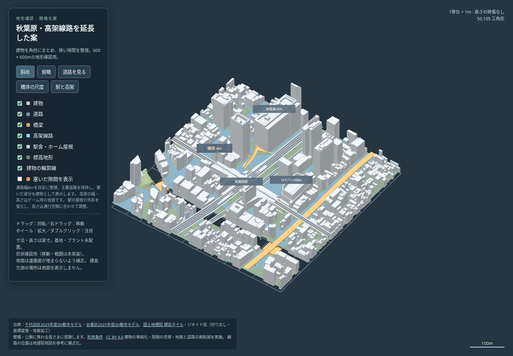

# 秋葉原・高架線路を延長した案

ユーザー指定（2026-10-22）：南北の山手線、その東側の新幹線、上を東西に渡る中央線を追加。「それっぽかったらいい」に従い、[簡略化した街区](../compact/README.md)へ模式的な高架を加えた。

[単体HTMLの3Dプレビュー](preview.html) / [俯瞰](top.png) / [駅と高架の拡大図](railview.png)

この形状で実機体を動かす[試走版](../trial/README.md) / [試走HTML](../trial/index.html)も用意した。川底・水面・護岸と、四辺の落下防止境界は試走版に追加している。



## 形と尺度

| 系統 | 方向 | 線路数 | 高架の幅 | 床の高さ | 縁の色 |
|---|---|---:|---:|---:|---|
| 在来線 | 南北 | 4 | 30m | 8m | 緑 |
| 新幹線 | 南北・在来線の東側 | 2 | 16m | 10m | 水色 |
| 中央・総武線 | 東西・上層 | 2 | 18m | 18m | 黄 |

高さは地面からの高さではなく、中心標高5.7mを0とする座標値。線形は地理院地図・写真・鉄道中心線を参考に丸め、幅・高さ・本数・柱位置はゲーム用の仮値。実際の勾配・地下への移行・駅舎・ホーム・分岐の精密再現は行わず、列車・架線・枕木も省略する。

3系統を600m四方の端まで延長する。線路帯と周囲1mから元の建物・充填棟を退け、線路上を空けた。南北の在来線（山手・京浜東北）と新幹線の高架下は、ユーザー指定により店舗16ブロックで埋める。店舗は陸地だけに置き、川と道路の横断部は残す。道路から2mを空け、店舗同士の間隔は最短約14.68m。窓と看板は帯状の面で表現し、細かい衝突物を増やさない。

高架の柱は2m角を端寄りに置き、道路から4mを空け、他線の交差部と川を避ける。店舗内部に隠れる34本を省き、12本を残す。レール・色帯・店舗の窓や看板は見た目専用。将来の衝突用体積案は高架床・柱・駅の屋根・店舗本体を含む [collision-volumes.json](collision-volumes.json)。

ユーザー指摘「駅舎消しちゃったのぉ？」に対応し、元のPLATEAU駅モデルの屋根の水平外形を使って、駅の屋根を復元した。線路帯の箱を除いた部分には厚さ0.6〜0.7mの屋根を戻し、南北の屋根上面15m・東西25.5mへ調整して線路上の空間を確保する。元の周辺建物・駅の側面に残した部分・線路の形は変更しない。屋根7領域、支柱15本、計536三角形を追加。下層の屋根は上層高架から水平8mを空け、その間に狭い袋小路を作らない。

「高架線路」「駅舎・ホーム屋根」「高架下店舗」で個別に表示切替。「駅と高架」では周囲の建物と駅を表示したまま拡大する。前の「高架の交差」は全建物を非表示にする視点だったため、駅舎そのものの削除と表示設定が混同されやすかった。基地・プラントは配置せず、[制作手順](../../WORKFLOW.md) の地形確認段階。

## 確認したこと

[形状検査](geometry-check.json) / [ブラウザ検査](browser-check.json) / [圧縮の比較検査](packing-check.json) / [既存形式の表示検査](regression-check.json) / [集計](summary.json) / [入力と道具の記録](generation.json)

- 全体51,376三角形。高架2,496三角形、復元した駅の屋根・支柱536三角形、店舗1,679三角形。店舗追加と隠れる柱の削除で、前版50,105から1,271増。
- 3系統の高架床が連続してマップ両端へ届く。線路間の交差部は上層下面と下層レール上端の間が約8.34m・6.34m、南北の高架間は最短約16.68m。
- 各系統76点で床の上面と地面から床までの距離を検査。店舗が入った部分は地上の通路ではない。残した柱12本が道路・他線の交差部に干渉せず、線路帯に元の建物が残っていないことを検査した。
- 駅の屋根約8,060㎡を復元し、元の駅の確認点(-25,40)で屋根上面25.5mを確認。線路上の屋根下面はレールから最小6.24m。支柱は線路の通行帯から外し、全屋根が描画メッシュにも存在することを検査した。
- 店舗16ブロック・約21,021㎡の実体を確認。道路と川へのはみ出しがなく、並行する店舗の間に8m以上を残す。地面・道路・既存橋梁・駅・既存建物の形状配列は店舗追加前と一致。有限値・600m四方の範囲内で、基地・プラント0を維持。
- Chromiumのオフライン表示で5視点・7地物・隙間表示・回転・拡大・移動・モバイル表示を確認。ブラウザエラー0、外部通信0。「駅と高架」で駅と周囲の建物が表示されることも検査。元の4地物のプレビューも圧縮対応のビューアで表示検査に成功。

## HTMLの容量

前の駅復元版3,142,698バイトから、店舗追加後も **1,268,463バイト（約1.27MB、59.64%減）**。同じ店舗付き地形を未圧縮で出すと3,210,674バイトになる。

座標とメタデータをgzip＋Base64でHTMLへ埋め込み、ブラウザ標準の `DecompressionStream` で展開する。外部の解凍ライブラリや通信は不要。7層全ての座標を実ブラウザでSHA-256照合し、メタデータと2視点の描画画像も未圧縮版と一致した。圧縮による形状の削除・量子化は行わない。

この削減量はHTML単体の保存容量。面数や展開後の描画負荷、ZIP・HTTPで圧縮した容量とは別に評価する。表示には `DecompressionStream` 対応ブラウザが必要で、未対応の場合は更新案内を表示する。比較用の未圧縮HTMLは `write_preview(..., compress=False)` で生成でき、次の検査へ渡せる。

```sh
node tools/test/plateau_pack_check.cjs /tmp/akihabara-raw/preview.html /tmp/akihabara-rail/preview.html /tmp/previous-preview.html
```

ここでの検査は形状と表示の検査。**本体の移動・射撃・衝突・Botには未接続で、実機体のスタックは未検証。** 本体へ取り込む際は、通行・頭上・高架への登り口・柱の回避・屋根からの乗り移りを実物理で検査する（知識台帳M01/M02/M28/M29）。

## 再生成

元の簡略化案をnpz付きで再生成した後、同じPython依存ライブラリで実行する。

```sh
python3 tools/plateau/add_rail.py /tmp/akihabara-compact /tmp/akihabara-rail --manifest /tmp/akihabara-cache/inputs.json --profile research/maps/akihabara-rail.json --station-source /tmp/akihabara-preview
python3 tools/plateau/rail_check.py /tmp/akihabara-compact /tmp/akihabara-rail
node tools/test/plateau_preview_check.cjs /tmp/akihabara-rail/preview.html
```

生データ・npz・参考写真はコミットしない。出典・加工内容・謝辞は [CREDITS.md](CREDITS.md)。
