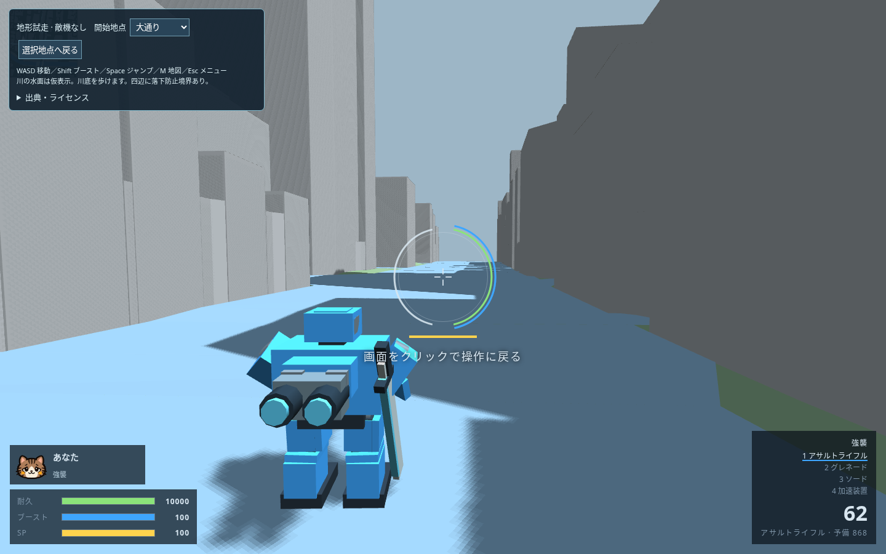

# 星路駅前試験区・実機体での地形試走

ユーザー指定（2026-10-22）：地形へ実機体を出し、ステージ端から落ちないようにする。[試走HTML](index.html)を保存して、現在のChromeまたはEdgeで開く。HTML単体で動き、通信やサーバーの起動は不要。

開始地点を選び、「試走を始める」で出撃する。WASDで移動、Shiftでブースト、Spaceでジャンプと滞空、Mで地図。Escでメニューへ戻り、開始地点を変更できる。機体・武器・兵装は本体と同じカスタマイズを使える。開始地点は大通り、駅の屋根、南北高架、東西高架、川底の5か所。高所の開始地点は形状確認用で、地上からの登り口の採用を意味しない。



基地・プラント・Botはまだ置かない。[制作手順](../../WORKFLOW.md)の地形確認段階を維持する。

## 接続したもの

確認済みの[高架・駅・店舗付きメッシュ](../rail/README.md)を、本体 `prototype/index.html` から作る専用の試走HTMLに組み込む。入力、機体の組み立て、武器、歩行・ブーストの速度、ジャンプ、重力、着地、ブースト消費は本体のコードを使用する。

- 建物・駅屋根・高架・店舗は、描画と同じ多角形の角柱999個で壁・床・天井を判定する。穴や斜めの壁を保持し、機体半径1.3m・高さ4mを使う。
- 地面と道路は元の三角形の面上で高さを求め、橋梁は元の床・下面・壁の三角形を判定する。都市モデルの道路縁を歩いて越えられるよう、試走版だけ段差の許容を0.4m増やす。登れる斜面の傾きは本体と同じ。
- 壁・屋根・橋・護岸は弾と視線を遮る。描画は層単位にまとめ、レイ判定用の形だけ32m街区に分ける。カメラが建物の中へ入る場合は壁の手前へ寄せる。
- 四辺は機体中心を±298.7m以内へ制限する。ジャンプ・ブースト・吹き飛ばし相当の高速移動でも境界の外へ出ない。薄い青色の境界面を表示する。
- 地面を省略していた川に、仮の川底・護岸・水面を追加する。川底は表示基準から-9m、水面は-5.5m。現実の水位・水深ではない。既存ゲームの水と同じく水面は見た目だけで、機体は川底を歩く。南北高架下の店舗を川へ増やさない。
- 面削減で生じた四隅の小欠け212㎡は周囲の高さの地面で閉じ、川とは区別する。ミニマップにも川・建物・高架・自機を表示する。

公開ゲームの `prototype/index.html`、既存マップ、生成済み `maps.js` は変更していない。試走HTMLは確認用の成果物で、通常のマップ選択へ配信する段階ではない。対戦用の施設・Bot経路・全街路の到達性・公平さは未確定。これらは地形の確認後に進める。

## 検査

[実移動の検査記録](movement-check.json)と[生成元・ハッシュ・面数](generation.json)を保存する。`city_trial_check.js` はオフラインChromiumで実キー入力を通して歩き、その後は同じプレイヤーの本体 `physics` を動かす。

開始5地点の接地、歩行とブースト、通常ジャンプと着地、屋根と上下高架への落下着地、天井への衝突、高架からの降下、外壁への歩行・ダッシュ、壁と屋根での射線遮断、橋の上と下、四辺・四隅への高速移動、軽量機と重量機を検査する。Escでメニューに戻り、開始地点を切り替えられることも確認する。これは抽出した代表地点の機能検査で、全通路でスタックしないことの証明ではない。

共通の本体やBotは変更していないので、試走版だけを専用検査する。施設配置前のBot戦や配布ZIPの作成は行わない。M01/M02/M28/M30の教訓に従い、元の形状表示と今回の実移動確認を区別する。

## 再生成

`tools/plateau/requirements-compact.txt` のPython依存と、リポジトリのPlaywrightを使用する。入力はGit内の圧縮済みプレビューと衝突用体積案で、取得キャッシュやNPZは不要。

```sh
python3 tools/plateau/build_trial.py mapdesign/akihabara_city/rail /tmp/city-trial
node tools/test/city_trial_check.js /tmp/city-trial
```

本体の接続箇所が変わった場合、生成器は停止する。生成HTMLを手で修正せず、`tools/plateau/build_trial.py` と `trial_runtime.js` を直して再生成する。

地理データと加工物の出典は[地形のクレジット](../rail/CREDITS.md)。試走用の川底・護岸・水面も地理データの加工としてCC BY 4.0。音とThree.jsを含めたクレジット全文をHTMLの「出典・ライセンス」に同梱している。公開データとソフトウェアを整備してくださった皆さまに感謝します。
