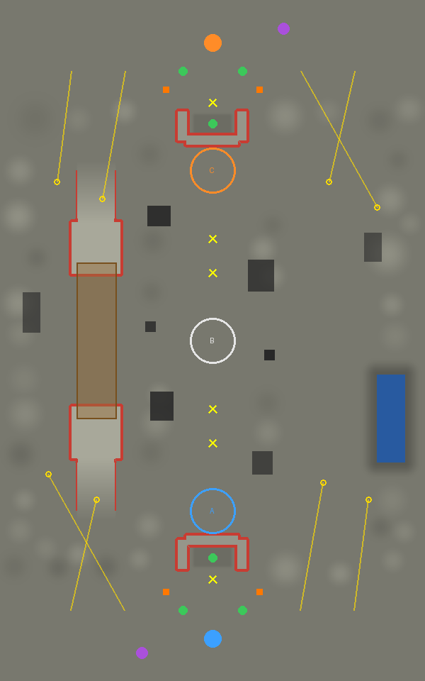
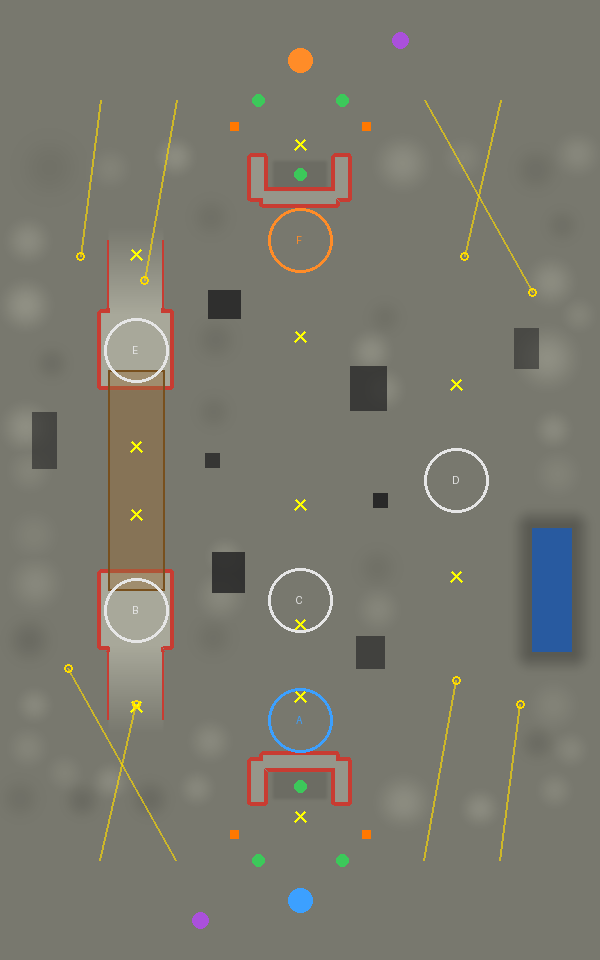
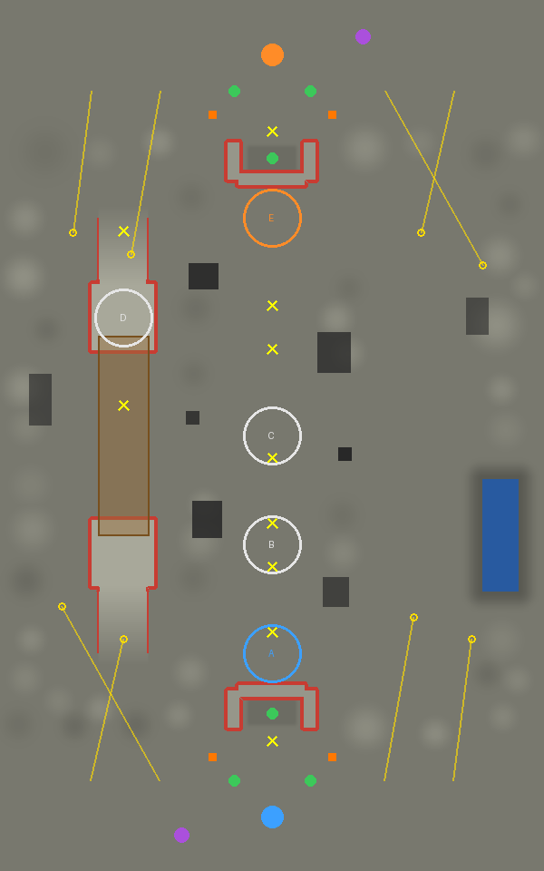
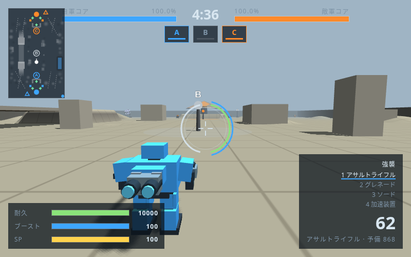
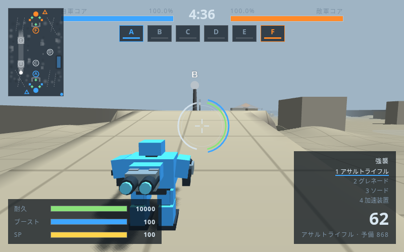
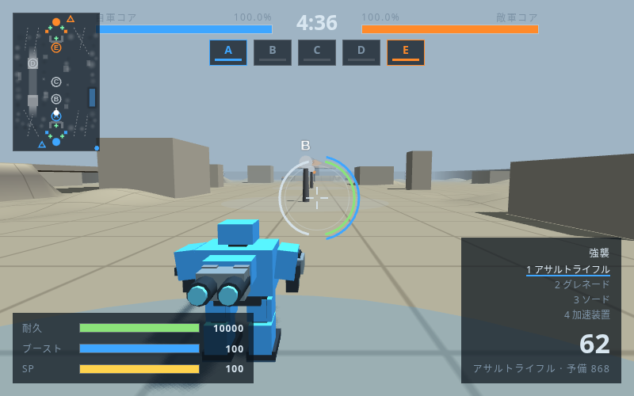

# 白煙循環区（circulation）制作メモ

Issue #1 の自動生成設計に沿って、地形の生成と施設配置の生成を分ける。生成結果は乱数シードと設定から再現し、ブラウザで地形・経路・施設を検査してから登録する。勝率は実対戦の必要数が集まるまで**勝率未確定**とする。

## 企画と決めた理由

- テーマは停止した熱交換施設。台地・街・港とは異なる、冷却設備の地上路と保守用高架、掘り下げた貯水区画を持つ産業施設とする。名前・配置・形はオリジナル。
- 5対5・5分、300m×480m。戦場の違いを確認しやすい規模に抑え、高架と地上の交差で縦方向の交戦を作る。
- 左側の高架と右側の地上路は異なる構造。地形・障害物・橋・水面・nav を全域指定する任意項目 `asym` を追加する。ベースの施設は従来どおり両軍へ対称配置し、既存4マップは指定なしで従来の挙動を維持する。
- ベースは z=±210、境目は±165。左右2基ずつのカタパルトは側面の前線手前へ着地させ、中央プラントには直行させない。レーダーは各軍の左奥、砲台2基・ポッド2基を置く。
- 最もベース寄りのプラントと隠れたポッドは共通地形で確保する。ポッドは高さ5mの土手と深さ2mの窪地に囲い、ベース側から入る。再出撃位置46〜52mを避けて遮蔽物を置く。
- 内側のプラント候補は地形の平坦面から抽出し、数・高所の比率・左右への分散が異なる配置を選ぶ。同じ地形で3戦場以上を作る。初期所有者は外側のみ青・橙、内側は中立。
- Bot は既存の攻撃・占拠・防衛・支援判断を使う。配置ごとに歩行可能な節点・接続をゲーム本体の地形と当たり判定から生成し、占拠や目標変更に応じた既存の再探索を利用する。見えない敵の完全な位置情報は与えない。
- 舗装路・広場と候補地点は `paved` に確保し、周辺の空地の起伏は `tools/gen_rough.py` で付ける。地形変更後は施設・経路・実走行の検証をやり直す。

生成コマンド、シード、段階ごとの検証結果、図は実装・検証後にこの文書へ追記する。

## 実装段階

この変更は設計書 §11 の **段階1〜5** を扱う。現段階の生成対象は「熱交換施設」の地形系統。高さ・通路位置・起伏をシードで決め、地形候補から配置を抽出し、歩行と施設の検査に通った**開発候補**をゲームに登録する。

| 段階 | 実装・確認 |
|---|---|
| 1 地形の保存・再読み込み | 地形シード、同梱の起伏生成、JS の保存・再読み込み。同じ設定でマップと maps.js のバイト一致を確認 |
| 2 複数配置 | 最大64案から、初動距離の極端な差を落とし、拠点数・高所・左右への分散が異なる3案を選抜 |
| 3 経路更新 | 各配置の実際の障害物・プラントを含む地形で接続を再生成。終点の到達高さも確認 |
| 4 実走行 | 軽量の強襲機と重装の重火力機で、両陣営からのベース間・上下段・各拠点への計104件の走行を確認 |
| 5 実対戦の収集 | 本体の loop を固定刻みで進める描画なし検査。撃破・占拠・所有時間・接地面と区域の利用・停滞の標本を保存 |

段階6〜8の原因別の局所修正、戦術構成を入れ替えた多数対戦、95%信頼区間によるバランス判定、統計的に合格した戦場の無人選抜は後続の対象。現在は**勝率未確定**。今回の3案は配置の静的な差とBot対戦の観測を記録した開発候補として扱う。Issue #1 は継続する。

失敗時には上限回数で次の地形シードへ移り、不合格理由を記録する。予算切れでは終了コード1となり、登録済みのマップと maps.js を保持する。手書きの既存マップは上書きしない。施設検査の結果は★の有無に加え、両側のポッドが見える件数とページエラーも確認する。

## 再生成する

リポジトリのルートで実行する。Node.js、Python 3、Playwright/Chromium を使い、俯瞰図には Pillow を使う。このクラウド環境では新しいシェルごとに `/workspace/.cloud-setup/core-breaker/env.sh` を読み込み、導入済み Chromium と HTTP 配信を使用する。

```sh
node tools/generate_map.js --seed 20261019 --placement-seed 20280950 --terrain-attempts 1 --placement-attempts 64 --variants 3
npm run test:mapgen
python3 tools/test/make_dbg.py dbg
node tools/test/map_check.js dbg circulation
node tools/test/map_check.js dbg circulation-v2
node tools/test/map_check.js dbg circulation-v3
node tools/test/map_battle.js dbg circulation,circulation-v2,circulation-v3 150 mapdesign/circulation/battles.json
npm test
```

省略時の上限は地形30回・配置64案・選抜3戦場。`--placement-seed` だけを変えると共通地形は保ち、配置と nav を再生成する。施設候補と舗装域は先に保護するため、プラントの位置ごとに起伏を作り直すことはない。作業用の候補・施設検査ログは ignored な `dbg/mapgen/` に置く。

生成器に個別の座標を手直しして合格させる手順はない。初動距離比1.35以下は配置の一次検査に使う直線距離の推定であり、実対戦で測った勝率ではない。経路の接続と高さ・走行は本体の処理で検証する。

## 保存した結果

- [generation.json](generation.json)：採用シード、設定、施設候補、選抜の静的な特徴、配置ごとの nav と104件の走行結果。
- [generator-tests.log](generator-tests.log)：生成器の5テスト。再現・再読み込み・配置差・予算・起伏の再実行・施設の誤判定を確認。
- [budget-test.json](budget-test.json)：予算切れの実行結果と登録済みファイルの保持確認。
- [battles.json](battles.json)：各150秒の実対戦記録。これは試合終了までの勝率検証ではない。乱数初期値を記録するが、ブラウザ対戦の完全な再現性は後続で検証する。

| 戦場 | 拠点数 | 主な配置の違い | 撃破 青/橙 | 所有者の変化 | エラー |
|---|---:|---|---:|---:|---:|
| circulation：中央冷却路 | 3 | 中央の1拠点を争う | 26 / 20 | 1 | 0 |
| circulation-v2：高架縦断 | 6 | 高架の両端と東側へ戦力を分ける | 20 / 20 | 4 | 0 |
| circulation-v3：片翼争奪 | 5 | 高所を片側に含め、中央の連絡を争う | 18 / 26 | 8 | 0 |

上の撃破と所有者の変化は v0.17 を取り込んだ状態で保存した各1回の観測値。階層の標本では、`upper` は地上高5m超の面に**接地している**生存機を1秒ごとに数え、カタパルト飛行やジャンプは高架利用として数えない。

3戦場とも `map_check` の★は0、両側の隠れたポッドは各173か所の格子から0か所、カタパルト8基の着地誤差は最大0.7m、ページエラー0。[中央冷却路](map-check-circulation.log)・[高架縦断](map-check-circulation-v2.log)・[片翼争奪](map-check-circulation-v3.log)に全出力を置く。

既存4マップは標準の `npm test` で再検証した。全194武器のエラーは0、Bot戦は city 155秒・wide 153秒・mesa 156秒・dock 18秒でエラーなし。dock はコスト制の戦力が0になり、規定どおり正常に試合終了した。既存マップの元データは変更していない。

標準の `bot_battle.js` でも新3戦場を153秒・152秒・152秒まで回し、すべてエラーなし。[全出力](standard-battles.log)と、v0.17 の[回帰テスト出力](regression-npm.log)、[検証概要](validation-summary.json)を保存した。

## 追加のBot対戦：10試合

5対5の既存Bot構成で、乱数初期値20261019〜20261028を変えて計10試合を終局まで実行した。プレイヤー機もBot化し、本体のゲームループを0.05秒刻みで進め、描画だけを省いた。全10試合が300秒の時間切れで正常終了し、合計50分のゲーム内時間、実行エラー0件。各試合で両軍の撃破とプラント所有者の変化を確認した。

| 戦場 | 試合数 | 青の勝利 | 橙の勝利 | 撃破合計 青/橙 | 所有者の変化合計 |
|---|---:|---:|---:|---:|---:|
| 中央冷却路 | 4 | 2 | 2 | 179 / 193 | 21 |
| 高架縦断 | 3 | 2 | 1 | 147 / 119 | 39 |
| 片翼争奪 | 3 | 0 | 3 | 133 / 145 | 36 |
| 合計 | 10 | 4 | 6 | 459 / 457 | 96 |

片翼争奪は今回3戦とも橙が勝った。各戦場3〜4試合で、戦術構成の入れ替えも未実施のため、地形や陣営による有利不利はまだ判定できない。**勝率未確定**を維持し、片翼争奪の偏りを追加検証の観点として残す。

高架上に接地した生存機の標本は、中央冷却路41件・高架縦断362件・片翼争奪349件。移動停滞の候補標本はそれぞれ40件・76件・52件だった。この値は1秒ごとの条件一致件数であり、連続した立ち往生の時間や経路探索失敗の確定件数ではない。

[試合ごとの記録](battles-10.json)に勝敗・終局理由・コア残量・撃破・占拠イベント・所有時間・区域標本を保存した。[集計と実行条件](battles-10-summary.json)にソースと実行器のハッシュ、コマンド、標本の意味を、[実行ログ](battles-10.log)に10試合の出力を保存した。初期乱数は記録するが、ブラウザ対戦の完全な再現性は未検証。

```sh
python3 tools/test/make_dbg.py dbg
node tools/test/map_battle.js dbg circulation,circulation-v2,circulation-v3,circulation,circulation-v2,circulation-v3,circulation,circulation-v2,circulation-v3,circulation 301 mapdesign/circulation/battles-10.json
```

検査秒数301は5分の制限時間を超えて指定している。本体の勝敗判定で止まり、制限時間以上を指定しても試合が終わらない場合は検査を失敗させる。勝者は表示用に丸める前のコア残量を使い、本体の `finish()` と同じ条件で記録する。

## 片翼争奪の追加10試合

前回の橙3勝を受け、地形・配置・ゲーム本体とBot構成を保ち、未使用の乱数初期値20261029〜20261038で片翼争奪だけを10試合追加した。全試合が300秒の時間切れで正常終了し、実行エラー0件。両軍の撃破とプラント所有者の変化も全試合で確認した。

| 対象 | 試合数 | 青の勝利 | 橙の勝利 | 引き分け | 撃破合計 青/橙 | 所有者の変化合計 |
|---|---:|---:|---:|---:|---:|---:|
| 今回の追加分 | 10 | 2 | 7 | 1 | 466 / 484 | 93 |
| 前回3試合との累計 | 13 | 2 | 10 | 1 | 599 / 629 | 129 |

累計の平均コア残量は青4371.69・橙5602.31で、橙が平均1230.62多かった。勝敗は今回のBot構成で橙に偏る結果が続いた。ただし地形・配置・Bot構成の影響は切り分けておらず、陣営を入れ替えた構成比較も未実施のため、**勝率未確定**を維持する。引き分けも分母に含めた橙勝利の割合は10/13（76.9%）、独立な試行と仮定した参考のWilson 95%区間は49.7〜91.8%。統計的な合格条件を満たしたという意味ではない。

拠点別では、中央Cの1試合当たり平均保有時間は青219.75秒・橙25.88秒、高架Dは青51.50秒・橙183.37秒だった。中央Cを青が長く保有しても勝敗は橙寄りとなっている。保有時間だけでは原因を特定できないため、今後の切り分けではコアへの侵攻経路と防衛、Bot構成の影響を確認する。

[追加10試合の記録](battles-v3-extra-10.json)、[実行ログ](battles-v3-extra-10.log)、[追加分と累計13試合の集計](battles-v3-summary.json)を保存した。集計には各拠点の所有時間、平均コア残量、区域・高架・移動停滞候補の標本とソースのハッシュを含む。

```sh
python3 tools/test/make_dbg.py dbg
node tools/test/map_battle.js dbg circulation-v3,circulation-v3,circulation-v3,circulation-v3,circulation-v3,circulation-v3,circulation-v3,circulation-v3,circulation-v3,circulation-v3 301 mapdesign/circulation/battles-v3-extra-10.json 20261029
```

末尾の開始シードは省略すると20261019。各試合で1ずつ増やし、0〜4294967295の範囲を超える指定は起動前に拒否する。初期乱数の記録は完全な対戦再現性を保証するものではない。

## 目視で検証する

[閲覧用ZIP](replay/replay.zip)を解凍して `replay.html` をブラウザで開く。停止・巻き戻し・速度変更・機体の選択・出撃ごとの軌跡・プラントの所有状態・コア被害の内訳を見られる。試合2の「橙の最初の凸」から、Dでの再出撃→西側の経路→青ベース侵入→コア命中を追える。[約1分の5倍速動画](replay/preview.mp4)も同梱。

過去13試合には位置が残っていなかったため、目視用に新しく3試合を記録した。これは昇降設備を追加する前のエンジンでの観測で、[実行条件・数値・使い方](replay/README.md)と元データを保存している。新しいジャンプパッドとリフトは[昇降設備試験場](../mobility/README.md)で検証する。main更新後の回帰結果も同フォルダを参照する。

## 図と画面

地形は共通で、プラント配置と通り道を切り替える。俯瞰図は北が橙、南が青。明るさは地面の高さ、赤は登れない斜面、茶色は高架、黄はカタパルトと再出撃位置、緑はポッド。見た目はグレーボックス段階。

| 中央冷却路 | 高架縦断 | 片翼争奪 |
|---|---|---|
|  |  |  |

[高架縦断の全nav](routes-v2.png)は別図に分けた。俯瞰図は `python3 mapdesign/map_top.py <id> <出力.png> --no-nav` で再生成できる。




