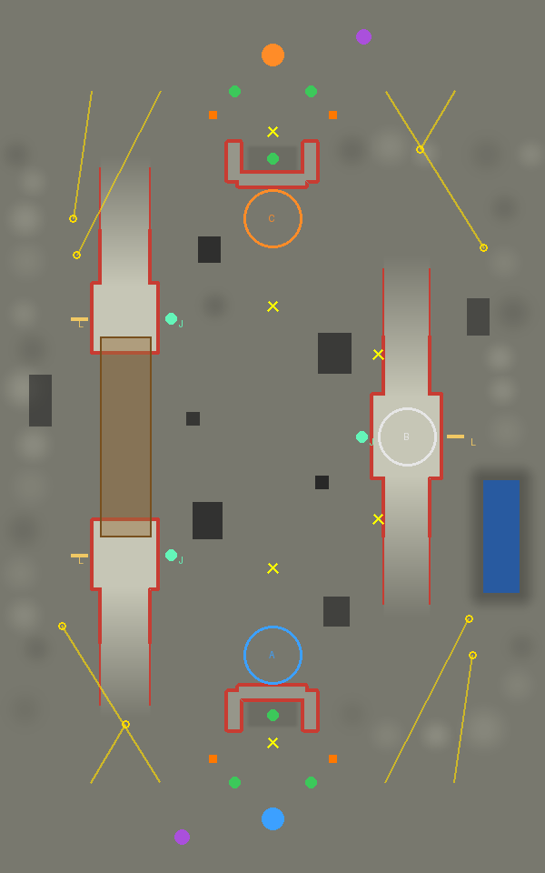
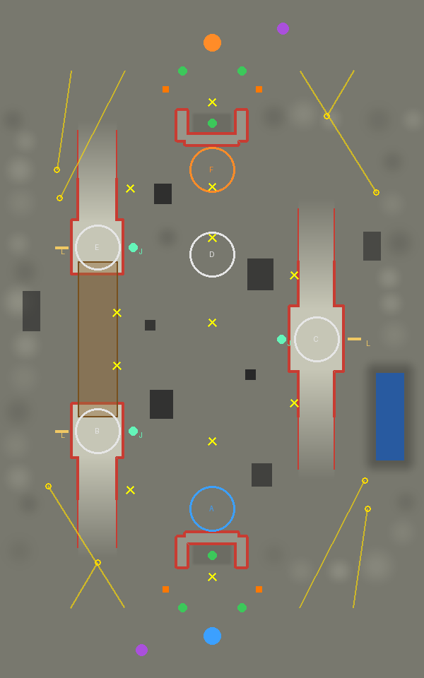
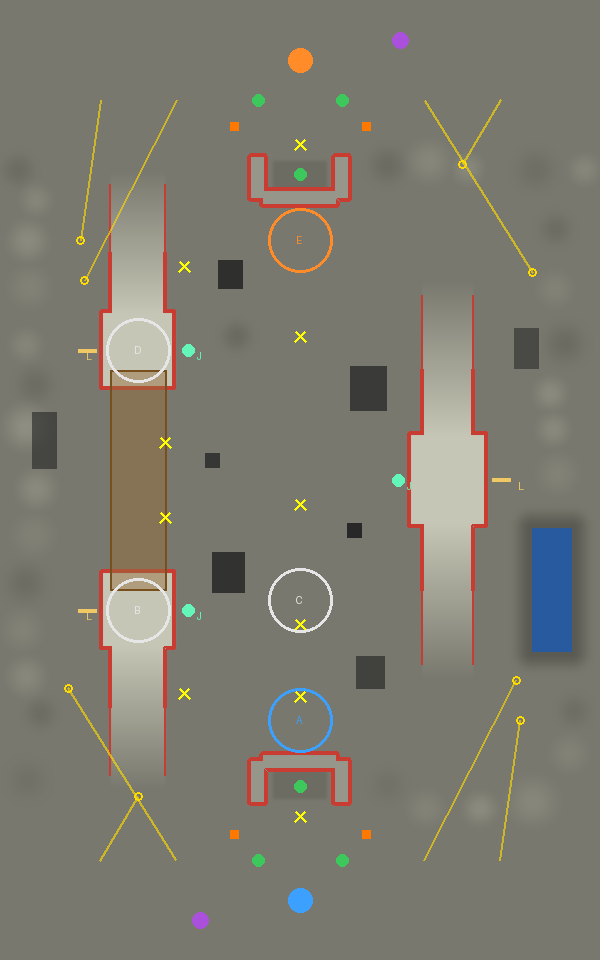
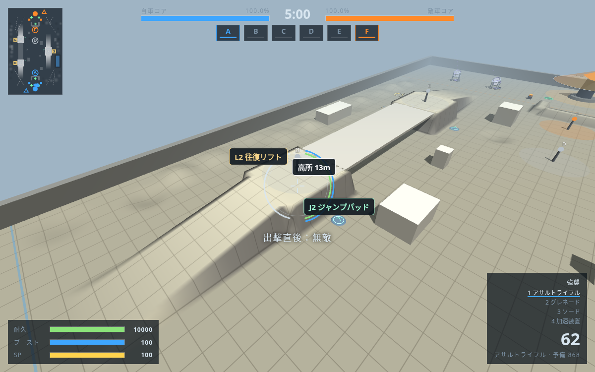
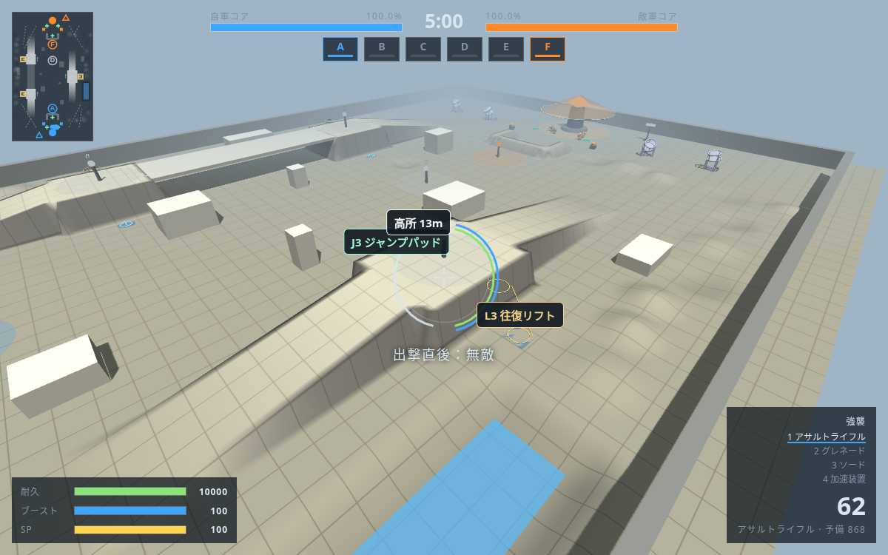

# 白煙循環区・昇降設備を前提にした再設計

旧地形の結果とは分けて保存する。西の保守高架を12〜14mへ上げ、東にも同じ高さの冷却塔広場を作る。各高所に、内側のジャンプパッドと外側の往復リフトを1基ずつ設ける。ジャンプパッドは速く上がれるが空中で姿を晒し、リフトは乗り場の待ち時間と外周への移動が必要になる。長い坂は徒歩で通れる迂回路として残す。

3戦場すべてに高所プラントを含める。少数拠点の昇降交差、多数拠点の高架縦断、地上と片側高所の片翼争奪を、共通地形と異なる配置から選抜する。両ベースからの主要な接続と、各パッド・リフトから高所への移動を軽量機・重量機の実物理で検査する。Botにも同じ設備選択と通常の移動を使わせる。

ベースへ直接飛び込む設備は置かず、カタパルトの着地点は高所の手前にする。ポッドの遮蔽・再出撃地点は維持する。舗装域で乗り場・着地点を保護したうえで、起伏と配置別の通り道を生成し直す。個別の生成結果を手直しして登録しない。

対戦と目視用記録はこの版の地形で取り直す。少数の試合では有利不利を断定せず、**勝率未確定**とする。

## 現在の配置と図

共通地形のシードは20261019、配置シードは20280950。西高架はx=-81・両端z=±65、東広場はx=74・z=0、高さは13m。パッドは理論上30mの垂直射出、リフトは8×8m・5m/s・端で2秒停止。本作の仮置き値であり、公式素材は使わない。

| 戦場 | 拠点 | 争う場所 |
|---|---:|---|
| 昇降交差 | 3 | 東広場の高所1拠点 |
| 高架縦断 | 6 | 西高架の両端・東広場・地上の連絡拠点 |
| 片翼争奪 | 5 | 西高架の両端と青側の地上連絡拠点 |

| 昇降交差 | 高架縦断 | 片翼争奪 |
|---|---|---|
|  |  |  |

図は北が橙・南が青。Jがパッド、Lがリフト。白い地形が高所、茶色が橋、赤線が登れない斜面。黄色はカタパルト・再出撃位置、緑はポッド。




## 移動の検証

- [生成時の検査](generation.json)：3戦場の歩行104経路、設備72経路が成功。歩行は軽量強襲機と重量重火力機で両ベース間・高架上下・各拠点へ移動。設備は全6基×2陣営×2機体×3戦場で、本体の設備目標選択とphysicsにより踏む/乗る/高所へ降りる。
- [本体Botの検査](bot-mobility.json)：48経路成功。各高所プラントを中立、他を自軍所有にした初期条件で、Botの占拠判断・経路探索・ゲームループを実行。両軍・軽量機・重量機がパッドとリフトから高所拠点へ到達。敵を止めた到達検査であり、対戦の勝率検証とは区別する。
- 設備の乗り場・着地点もnavの候補に含める。歩行リンクには歩ける接続だけを保存し、昇降は設備用の目標選択で扱う。坂の側面を斜めに登る偽の接続はX/Z方向の傾斜でも除外する。
- 開発中に、坂の側面での引っ掛かりと重量機の横移動不足を実走で検出した。経路の傾斜判定とパッドの横間隔を生成器で修正し、再生成・再検証した。リフトの上端は崖の外側へ接岸する。

## 新地形のBot戦：10試合

初期乱数20261060〜20261069、5対5・5分。全10試合が300秒の時間切れで正常終了し、各試合で両軍の撃破・所有者の変化を確認、エラー0。

| 戦場 | 試合数 | 青勝 | 橙勝 | 分 | 撃破 青/橙 | 所有者変化 |
|---|---:|---:|---:|---:|---:|---:|
| 昇降交差 | 4 | 2 | 2 | 0 | 121 / 137 | 30 |
| 高架縦断 | 3 | 1 | 0 | 2 | 107 / 103 | 30 |
| 片翼争奪 | 3 | 1 | 2 | 0 | 99 / 110 | 24 |

[試合ごとの結果](battles-10.json)に勝敗・コア・撃破・所有時間・区域標本・設備イベントを保存。設備は0.05秒ごとの読み取り専用標本で、パッド射出724回、高所への着地566回、リフト乗車5回、高所への下車1回を記録した。射出後の撃破・落下や、移動中の降車もあり、乗車数を到達数として数えない。**通常の対戦ではパッド選択が多く、リフト利用は少ない**。到達できることと、実戦での選択頻度は別に評価する。

旧地形の片翼争奪13試合とは別集計。今回も各戦場3〜4試合で、構成入替・反転比較をしていないため、陣営バランスと改修の因果効果は未判定。**勝率未確定**。

## 目視する

[閲覧用ZIP](replay/replay.zip)を解凍し、`index.html`を開く。3戦場から選び、「場面を探す」のパッド射出・着地、リフト乗車・高所への下車を押すと、8秒前から追える。機体を選び、停止・巻き戻し・速度変更・出撃ごとの軌跡も使える。

目視用には別途、初期乱数20261070で各戦場1試合・300秒を記録した（計3試合、エラー0）。上の10試合の映像を推定したものではない。各フォルダの `recorded.json` が元の観測値、`summary.json` がコアHP差と被害内訳の照合結果。エンジン・マップ・記録器のSHA-256を保持する。記録時は未コミットの作業ツリーであり、`sourceCommit` は作業の基点。

**高架縦断の「リフトから高所へ下車」には3:54.30の橙5・L2がある**。3:46.30から再生し、乗車・上昇・高さ13mの床への下車を確認できる。同フォルダの `preview.mp4` はこの試合を5倍速にした約1分の動画。閲覧HTMLはデータを内蔵し、外部通信せず開ける。

## 再生成と検査

クラウドでは新しいシェルで環境設定を読み込む。

```sh
source /workspace/.cloud-setup/core-breaker/env.sh
node tools/generate_map.js --seed 20261019 --placement-seed 20280950 --terrain-attempts 1 --placement-attempts 64 --variants 3
npm run test:mapgen
python3 tools/test/make_dbg.py dbg
node tools/test/generated_mobility_check.js dbg mapdesign/circulation/v2/bot-mobility.json
node tools/test/map_check.js dbg circulation
node tools/test/map_check.js dbg circulation-v2
node tools/test/map_check.js dbg circulation-v3
node tools/test/map_battle.js dbg circulation,circulation-v2,circulation-v3,circulation,circulation-v2,circulation-v3,circulation,circulation-v2,circulation-v3,circulation 301 mapdesign/circulation/v2/battles-10.json 20261060
npm test
```

リプレイは `make_dbg.py dbg --trace` の後、`record_battle.js dbg <id> <出力先> 20261070` で記録する。位置は0.25秒刻み、設備・出撃・被害等は0.05秒刻み。`export_replay.js <recorded.json> <出力先> 0 --video --mobility` で保存済み観測から動画を書き出せる。`replay_check.js <replay.html>` はイベント選択・HP内訳・停止と再生・390px幅・外部通信なしを確認する。初期乱数の保存だけではブラウザ対戦の完全な再現性を保証しない。

## 最終確認

[検証概要と実ファイルのハッシュ](validation-summary.json)に実行対象を記録。基点mainは `3af0dbe`。3戦場とも施設検査の★0、隠れたポッドは両側各173点から可視0、カタパルト8基の最大着地誤差0.6m、ページエラー0。

[標準回帰テスト](regression-npm.log)も成功。全204武器のエラー0、既存4マップはcity 151秒・wide 154秒・mesa 154秒まで進行し、dockは20秒で戦力が0になり正常終了、全てエラーなし。通常速度のメニューから3戦場を選んで出撃し、時計が5:00→4:59へ進むことも確認した。

新リプレイ3本は、イベントの表示・時刻と機体の選択・コア被害内訳・再生・390px幅・外部通信なしを実ブラウザで検査した。高架縦断では4種類の昇降イベントそれぞれから8秒前と対象機体へ移ることも確認。旧版の3試合入り閲覧HTMLも操作検査を通過した。新しいビューアーは時間軸の固定部分を一度だけ描き、再生・書き出し時に毎回全履歴を描き直さない。動画は60.125秒で、全体をデコードしてエラー0。

## 追加：各4戦の観測勝率

現在の地形・本体を固定し、未使用の初期乱数20261071〜20261082で**各4試合、計12試合を新しく実行**した。前の10試合・目視用3試合は今回の分母に含めない。全12試合が300秒で正常終了し、両軍の撃破・所有者の変化を確認、エラー0。

**勝率＝勝利数÷4×100**。引き分けも全4試合に含める。

| 戦場 | 青勝 | 橙勝 | 引き分け | 青勝率 | 橙勝率 | 引分率 |
|---|---:|---:|---:|---:|---:|---:|
| 昇降交差 | 1 | 3 | 0 | 25% | 75% | 0% |
| 高架縦断 | 2 | 2 | 0 | 50% | 50% | 0% |
| 片翼争奪 | 1 | 3 | 0 | 25% | 75% | 0% |

[全12試合の元記録](battles-4-each.json)・[実行ログ](battles-4-each.log)・[勝率と実行条件](battles-4-each-summary.json)。地形・ゲーム本体・記録器のハッシュと、参考のWilson 95%区間も集計に残す。

各4試合の観測値であり、構成を入れ替えた比較は未実施。**陣営バランスは勝率未確定**。
