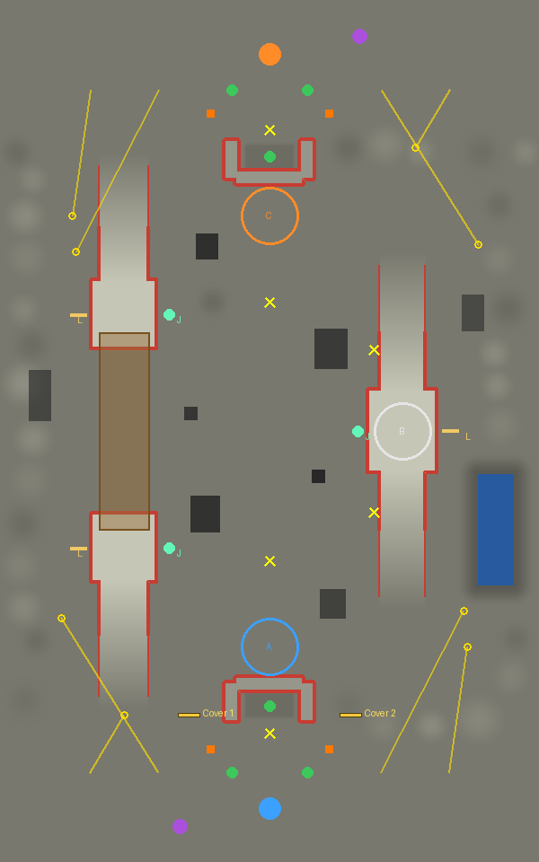
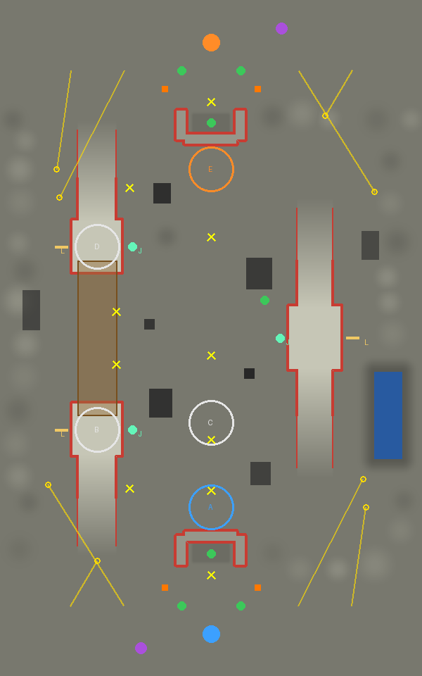

# 迎撃の足場と中央補給圏の修正

2026-10-20（日本時間）。[前回の診断](../v2/initialization-check/README.md)を受けて、プラント位置を固定したまま遮蔽・退避・補給を比較した。**最新250武器版で改善を再現できなかったため、追加配置は不採用。登録は `reviewed250` として基準配置を維持する**。[最新版の結果と採否](main250/README.md)を参照。以下はv0.18での設計実験の履歴であり、最新版の勝率ではない。勝率の統計的合格・青の大破数減少は未達。公開版の配布ではない。

## v0.18で試した候補（最新版では不採用）

- **昇降交差**：青ベース手前の外側に、幅12m・奥行2m・高さ4.5mの壊せる遮蔽を2枚（x=±45、z=158）。中央の視界と両端を回る横道を残す。`cover2` の配置を採用した開発候補。
- **片翼争奪**：既存建物の南側 `(38,-27)` に、既存の中央プラントCと連動するリペアポッドを1基。Cを所有する陣営が利用でき、中立時は使えない。追加の壁は採用しない。補給点へのnavを再生成した。
- **高架縦断**：対照として物理・施設・navを維持。[全項目の一致](control-data-check.json)を確認した。全戦場のプラント、共通地形、ジャンプパッド3基・リフト3基・徒歩坂も固定。

## 仮説が外れた点

1. **遮蔽を足せば迎撃しやすくなる、とは限らなかった。** `cover1` はベース内側の縦壁。昇降交差は青2勝2敗→1勝3敗、受けた直接コア被害は4,386→10,587.75。seed20261103の編成入替戦では189.05秒で青コアが破壊され、壁は両方残存した。壁は敵側にも使え、壊せることだけでは射線の問題を解消できない。個々の壁が敗北の唯一の原因とまでは確定していない。
2. **退避路の遮蔽だけでは、補給圏外を直せなかった。** 片翼争奪の壁2案はいずれも青の大破損失を減らせなかった。本体の `nearestPod` は90m以内の味方ポッドだけを選ぶ。大破分布から選んだ中央2地点では、元のポッドを選べない。新ポッドまでの距離は45.7m／65.8mで、同じ条件で本体Botが3.7秒／6.0秒で到達し95%まで回復した（[機能検査](retreat-pod.json)、敵は退避させた条件）。
3. **初期状態の一致だけでは比較条件を揃え切れなかった。** 最初の比較は、変えていない高架縦断の結果までずれた。初回出撃で暖まった武器形状キャッシュがUUID用乱数の消費を変えていた。[この24戦は採否から除外](cache-uncontrolled/README.md)。キャッシュを初期化し、編成抽選・出撃/装備・初動選択の乱数を機体ごとに揃えると、対照4戦の全対戦記録が一致した。

これらを [知識台帳 M03〜M10](../../LESSONS.md)へ蓄積した。次のマップ設計では `docs/codex/map.md` からこの台帳を読み、関係する知識IDを企画へ引用し、採用・棄却の両方を追記する。

## 比較条件

エンジンはv0.18、main `a39ac62`を取り込んだ基準HEAD `3c6077e`。全員を本体の通常Bot生成に通し、無音・固定dt=0.05秒。`paired-rosters-v2` は機体・装備・初動を固定し、同じ2編成を青橙で入替して各4戦。変更前後の全10機の初期状態を照合した。戦闘中の経路・判断・乱数消費は分岐する。通常のゲームのルールは変えていない。

| 戦場 | 編成seed（各々を入替） | 基準 | 壁1案 | 壁2案 | 最終候補 |
|---|---|---:|---:|---:|---:|
| 昇降交差 | 20261103 / 20261104 | 2－2 | 1－3 | 3－1 | 3－1（壁2案を維持） |
| 高架縦断 | 20261101 / 20261102 | 1－3 | 1－3 | 再利用 | 再利用 |
| 片翼争奪 | 20261105 / 20261106 | 2－2 | 2－2 | 2－2 | 3－1（中央補給点） |

数値は「青勝－橙勝」、引き分けなし。高架縦断は壁1案と基準で、勝敗・実HP・撃破・占拠・昇降観測など全項目が一致。壁2案以後は無変更の対照結果を再利用した。昇降交差も最終候補では壁2案の結果を再利用。新しく実行した選抜比較は **12+12+8+4=36戦**。[再利用の内訳](repair3-reuse.json)。比較コードは再利用を新規実行として数えない。

前回の通常Bot4戦とは編成の抽選条件が違うため、勝敗を混ぜない。各4戦の青勝率50%のWilson 95%区間は約15〜85%、75%なら約30〜95%。勝率未確定。

### 被害内訳（各4戦の合計）

| 戦場・案 | 青が受けた直接攻撃 | 橙が受けた直接攻撃 | 青の大破損失 | 橙の大破損失 |
|---|---:|---:|---:|---:|
| 昇降交差・基準 | 4,386 | 312 | 8,268.75 | 8,212.50 |
| 昇降交差・壁1案（棄却） | 10,587.75 | 1,921.55 | 6,243.75 | 6,131.25 |
| 昇降交差・壁2案 | 1,174 | 3,839 | 7,987.50 | 8,606.25 |
| 片翼争奪・基準 | 0 | 166.35 | 7,931.25 | 7,200 |
| 片翼争奪・壁1案（棄却） | 1,483 | 728 | 8,437.50 | 7,931.25 |
| 片翼争奪・壁2案（棄却） | 0 | 1,395 | 8,831.25 | 7,425 |
| 片翼争奪・中央補給点 | 0 | 711.50 | 8,268.75 | 8,100 |

片翼争奪では大破損失の青橙差は731.25→168.75に縮小したが、青自身の損失は337.50増えている。**ポッドを選択・利用できる改善と、絶対的な大破数を減らす課題を分ける**。試合中の新ポッドでの補給開始は青が計9回、橙0回。C所有に依存する前進補給のため、敵に奪われた場合の影響も今後の検証対象。

### 選抜に使わなかった編成

各戦場で別の1編成を青橙入替し、変更前後を2戦ずつ追加（計8戦）。[別集計](holdout-summary.json)。昇降交差は1－1→1－1、片翼争奪は1－1→2－0。初期状態は全試合で一致し、全300秒完走・エラー0。

昇降交差の平均コア差（青－橙）は+161.65→−284.88で悪化し、選抜4戦で見た改善をこの編成では再現できなかった。片翼争奪も青の大破損失は3,825→4,331.25に増えており、勝敗の改善だけを生存性改善とは呼ばない。次は新しい戦術構成で、侵入前の迎撃成功と、ポッド利用後の生還・再合流まで測る。

## 目視

[比較ビューアZIP](replay/comparison.zip)をダウンロード・解凍し `index.html` を開く。外部通信不要。変更前・棄却案・現在候補を同じ編成で見比べられる。

- 昇降交差の棄却例：seed20261103・入替。`cover1-c-swap` の「コア命中」→橙4の最初の命中46.45秒から追う。189.05秒で終局。壁の残耐久も記録し、破壊された壁は消える。
- 同じ編成の基準版は `before-c-swap`。通常配置の基準と採用候補は `before-c` / `cover2-c`。
- 片翼争奪：`before-v3` / `cover2-v3` / `repair3-v3`。最終候補の「ポッドで補給開始」から168.50秒の青4、200.65秒の青1へ飛び、退避経路を追える。緑のPがポッド、緑の機体枠が補給中。

リプレイは実対戦の新しい観測記録。位置は0.25秒、イベントは0.05秒。コア命中の座標は命中時の攻撃機の現在位置であり、発射点や弾道ではない。[対戦器との7記録の照合](recorder-consistency.json)で初期状態・終局HP・撃破・占拠数を確認した。

## 検査と記録

- [generation.json](generation.json)：軽量/重量機の主要104経路と、両軍・全設備の72乗降を実物理で完走。
- [cover-routes.json](cover-routes.json)：横道・両軍の既存ポッドまでの20経路と実際の回復。
- [retreat-pod.json](retreat-pod.json)：損傷Botの新ポッド選択・実走・95%回復。
- 3戦場の `*-facilities.log` / `*-full.log`：★なし、ページエラー0、外側ポッドは両軍とも173地点からの視認0。新中央ポッドは313地点中105地点から見える。中央の完全遮蔽は必須要件ではなく、側面から攻撃可能な補給点として扱う。カタパルト全基は規定の6m以内。
- `unit-check.log`：生成6件・施設スキーマ2件合格。`paired-rosters-check.json` は戦場を変えても初期状態一致・全構成入替を確認。`ordinary-initialization-check.json` は通常操作への復帰を含む4seed。`determinism.json` は20秒の状態列一致。
- `replay/*/viewer-check.json`：イベント遡り・終局HP・再生・390px幅・外部要求なし。遮蔽の耐久・破壊後の消失も扱う。
- [source-manifest.json](source-manifest.json)：基準コミットと各ソースのSHA。記録内の `sourceCommit` は実行時の基準HEADで、未コミットの変更はソースSHAと候補データで識別する。

`before.json`・`cover1.json`・`cover2-new.json`・`repair3-new.json` が実行単位の結果。`cover2.json` と `repair3.json` は同一条件の無変更戦場を含めた比較用の集約で、新たな対戦ではない。各 `*-comparison.json` には試合別HP・被害・Wilson区間も保存。棄却した地形データは `candidates/`。

再生成：`node tools/generate_map.js --seed 20261019 --placement-seed 20280950 --terrain-attempts 1 --placement-attempts 64 --variants 3 --revision reviewed250` が最終登録。`repair3` は当時選抜した補給点案、`baseline` / `cover1` / `cover2` は基準と旧案を再現する。基準の完全な入力は `git show 3c6077e:prototype/maps/circulation.js`。

対戦は `make_dbg.py dbg --trace` の後、`map_battle.js dbg <同じマップを2回ずつ並べた一覧> 301 <出力.json> <seed> --paired-rosters`。`--map-source <旧案.js>` で変更前を比較する。記録器は同じ条件に `--paired-rosters`、入替編成なら `--swap-rosters` を指定する。

今後は多数対戦・複数戦術と、回復後の生還・再進軍の評価が必要。原設計書の完全自律選抜を完成したとは扱わない。
