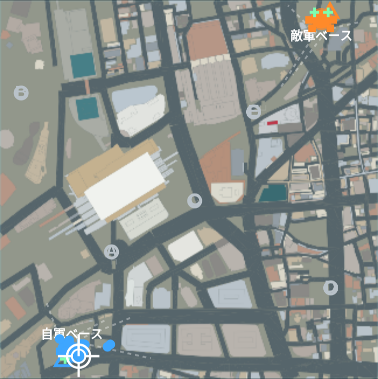
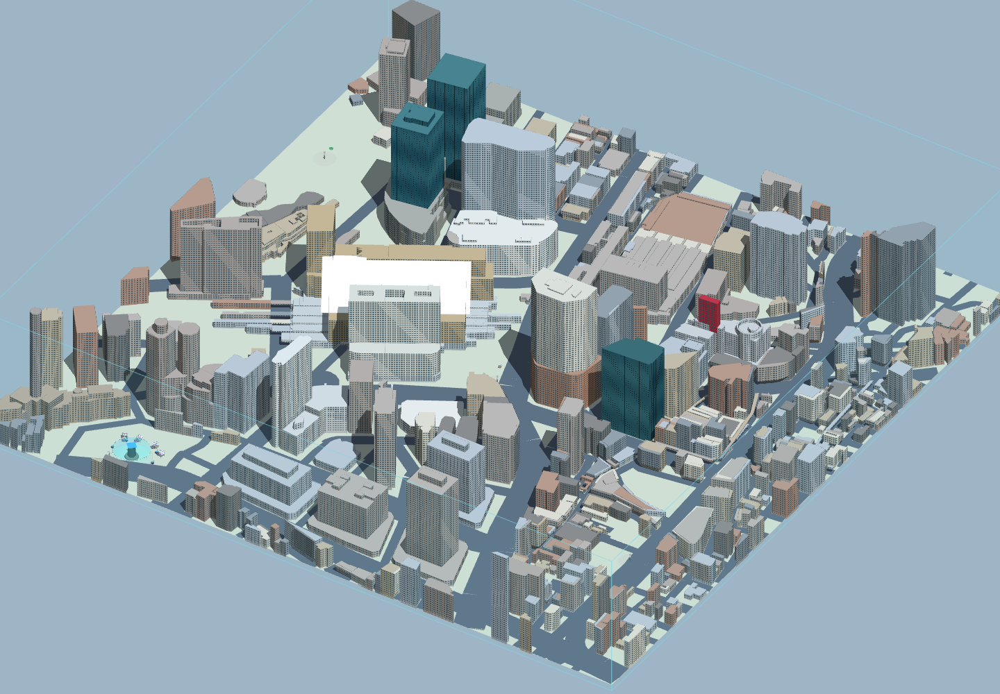
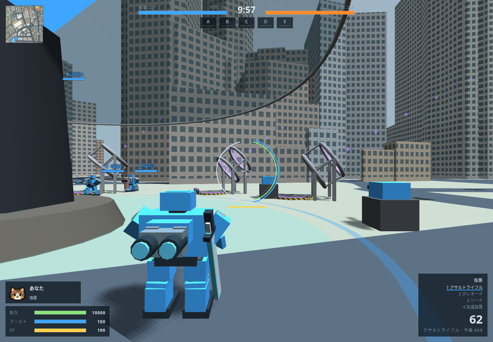

# 環都駅前・五街区争奪戦

梅田のPLATEAU建物と国土地理院の道路から再構築した1km四方を、通常の機体・武器・HUDで遊べる10対10のマップへ接続した。IDは `kanto`。通常の `prototype/index.html` のマップ選択に表示する。[確認用HTML](play.html)は同じ本体と素材を使い、このマップを選択済みにしている。

## 配置

ユーザー図の南西に青基地、北東に橙基地を置き、赤いPの5地点を中立プラントにする。各基地のカタパルト4基・砲台4基・レーダー1基・補給ポッド2基、各プラントにポッド1基。試合は10分。ジャンプパッドは両陣営とも0基。

| 施設 | x, z（m、北が-z） | 図との対応 |
| --- | --- | --- |
| 青基地 | -310, 430 | 南西の囲み |
| 橙基地 | 350, -450 | 北東の三角形 |
| A | -205, 165 | 中央駅の南西 |
| B | -444, -255 | 西の空地 |
| C | 15, 30 | 中央の交差点 |
| D | 375, 260 | 南東の街区 |
| E | 171, -205 | 北東の道路脇 |

基地の囲みとプラントの半径18mだけ建物を切り、道路と大きな路地を残した。A/Eのポッドは深さ2mの窪地・3面の5m壁と歩いて出られる坂で隠す。両陣営から各プラントへの再出撃候補を6地点ずつ、自軍基地側46〜52mに置く。カタパルトの降り先は空中経路も建物に当たらない街路から選ぶ。

## 外観

公開外観写真と位置を確認し、9か所を目印として配色した。中央駅は銀色の屋根・砂色の北棟・白灰色の南棟、北側高層群は青緑のガラス、大型店舗は白銀、東側百貨店は茶色の低層部と白い上層部。観覧車のある商業施設は既存の上部構造を赤い目印にし、東のガラス棟は深い青緑、西の石調ビルは暖灰色にした。一般の建物は8色の落ち着いた石・金属色で分け、同じ建物の上下はそろえる。ミニマップも同じ色を使う。

資料・実物との対応は [外観の採用記録](../../research/maps/umeda-landmarks.json)。ゲーム画面には実在の名称・看板を出さない。写真を素材として取り込まず、既存形状の色と窓の描画だけを変えている。公開モデルの収録時期による差は残す。例えば南側百貨店の入力モデルには新しい高層部がなく、着色に合わせて建物を足すことはしていない。

白い大屋根は駅舎と線路の向きに合わせた約200m×92mの傾斜板1枚。北側76mから南側50mへ下げ、上面・下面・縁を含む12三角形で表現した。対戦用の接地・弾判定も同じ板を使い、マップデータの増加は327 B。元の建物は削っていない。

## 容量・再現

承認済み地形commit `901911e` の入力を [source/layout.json](source/layout.json) に保持する。ハッシュは [generation.json](generation.json)。基地・プラントの空地、補給所、街路経路、安全な再出撃と配色は `tools/build_kanto_map.py` で再現する。元の入力は上書きしない。

- マップ全体のJSON：**93,806 B**。コメントを含むJSファイル：**94,006 B**。どちらも非圧縮で100,000 B以下。
- このうち形状と配色：**82,068 B**。描画形状：**22,384三角形**。写真テクスチャは0枚。
- 輪郭・地面は2cm格子の16bit座標。地上のBot経路は4m格子から生成し、655節点・1,026辺を16bitで保存する。本体が施設付近の通れない19辺と孤立した4節点を除き、651節点・1,007辺を使用する。
- 地形の追加通信は0件。通常本体のThree.js・フォント・音源を共用する。確認用HTMLは共通本体も含むため、上のマップデータ容量とは別。

```sh
# 生成時だけ NumPy / SciPy / Shapely / mapbox-earcut が必要
python3 tools/build_kanto_map.py
python3 tools/build_maps.py
python3 tools/build_kanto_play.py
python3 tools/test/city_map_format_check.py
python3 tools/test/make_dbg.py dbg
node tools/test/kanto_check.js dbg 600
node tools/test/kanto_input_check.js
node tools/test/kanto_canopy_check.js dbg
node tools/test/map_check.js dbg kanto
node tools/test/hoshimichi_integration_check.js dbg
node tools/test/quick_check.js origin/main 60
node tools/test/bot_battle.js dbg city,wide,mesa,dock 150
```

## 動作確認

本体の移動・占拠・射撃・勝敗処理で検査した。[対戦記録](battle-check.json)は20機すべてをBotとして動かした600秒を上限とした屋根追加後の1試合。約245秒で青コアが破壊され、85撃破・7占拠・51回射出で正常終了し、全5プラントの占拠と両コアへの攻撃が起きた。陣営別の勝率は未確定で、長期の公平さやFPSの測定は行っていない。

専用検査はカタパルト48条件（軽量・標準・重量、30/120Hz、初回接地の最大誤差2.20m）、再出撃240サンプル、両基地から全プラントへの実機体の徒歩10経路、補給制約と坂からの退出、砲台・レーダー、占拠と再出撃を確認した。A/Eポッドは敵陣側の104/84地点から見えず、施設・経路検査の警告0、ブラウザエラー0。

[実入力の記録](input-check.json)は通常本体と同じ確認用HTMLで、両基地からの出撃・W移動・全体マップ・設定からの再開を確認したもの。着色後にも実描画を行い、地形の外部通信0・ブラウザエラー0。[大屋根の検査](canopy-check.json)では傾斜の異なる3地点で上下の弾判定と機体の着地を確認した。色分けは既存の形状・施設・経路を変えず、大屋根の面だけを追加した。従来7マップの定義、294武器・72パーツの値は変更していない。

| 出発基地 | A | B | C | D | E |
| --- | ---: | ---: | ---: | ---: | ---: |
| 青 | 37.0秒 | 82.7秒 | 58.4秒 | 77.7秒 | 92.0秒 |
| 橙 | 99.9秒 | 88.6秒 | 71.9秒 | 81.1秒 | 38.9秒 |

上表は専用検査の重量機で、ジャンプ・ブースト・カタパルト・交戦を使わず、本体の経路と物理で各1回歩かせた実測。平均移動時間や初動の競争結果を意味しない。長距離の拠点BとDを含む配置の公平さは実戦で継続調整する。





斜め俯瞰は通常本体の形状・材質・施設を、確認用の固定カメラから描画したもの。全域を見せるため、この画像の撮影時だけ霧を外している。



地理データの出典・加工内容・謝辞は [CREDITS.md](CREDITS.md)、取得した元タイルは [source-manifest.json](source-manifest.json)。`source/source-check.json` は取得直後の9メッシュの検査であり、この対戦用地形の起伏や施設の検査結果ではない。
