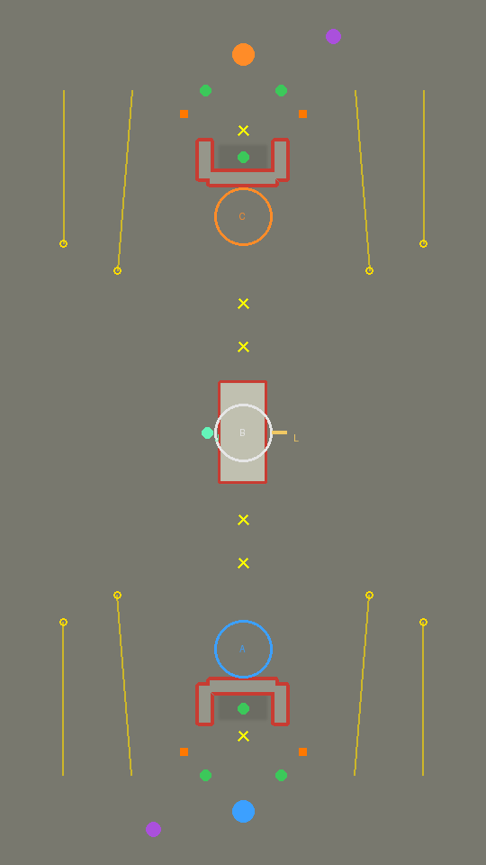
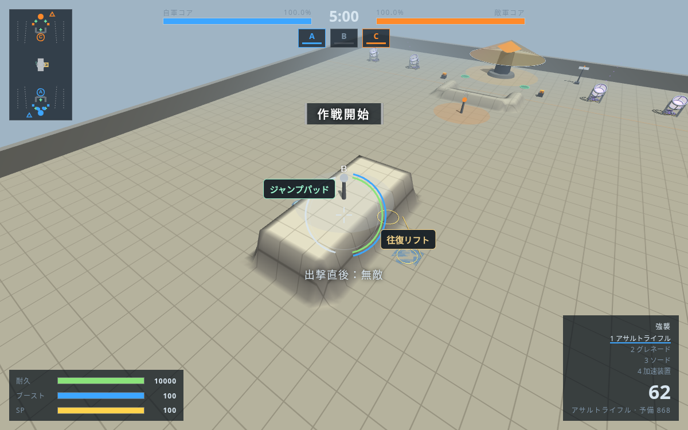

# 昇降設備試験場

ユーザーの追加依頼によるジャンプパッド（垂直射出装置）とリフト（運搬用の移動床）を目視・実走で確かめる専用マップ。5対5・5分、270×480m。中央プラントBは高さ12mの台地にあり、通常ジャンプでは届かない。西の緑の装置を踏むと垂直に射出し、東の台は下と上を往復する。新設備の挙動を比べるため、白煙循環区の地形や施設配置は変更しない。

設備の位置を固定した、手書きの動作試験マップとして扱う。

ゲームのマップ選択で「昇降設備試験場 〜垂直射出と運搬〜」を選ぶ。中央へ進み、パッドは踏んでから空中操作で台地へ、リフトは下端で乗って台地へ降りる。リフトからは歩く・ジャンプで離れられる。

公式の[施設紹介](https://borderbreak.com/game/intro/facility/)にある「垂直射出」「高所へ移動する運搬設備」を参考にした。床の形、光るリング、支柱などは本作のオリジナル。試験場のパッドは理論上28m上昇、リフトは8×8m・5m/s・両端2秒停止という仮置きで、公式の性能値として扱わない。

## 配置

西のパッドは(-20,0)、着地先は(-6,0)の高さ12m。水平速度は加えず、空中操作だけで着地する。東のリフトは(24,0,高さ0)と(16,0,高さ12)を往復する。両陣営の最寄りプラントと隠したポッド、ベースの施設も置き、通常の対戦として動かす。勝率は未確定。



俯瞰図のJがジャンプパッド、Lがリフト。数値の指定と項目の説明は `prototype/maps/README.md`。



[設備を使うBot戦の俯瞰リプレイ](replay/replay.html)も保存した。ジャンプパッドはJ、リフトはLと現在の床の高さで表示する。HTMLを保存してブラウザで開くか、白煙循環区の[閲覧用ZIP](../circulation/replay/replay.zip)に同梱した `mobility-replay.html` を開く。

## 検証

`check.json` に実動作の結果を保存する。プレイヤーと両軍Botの垂直射出・高さ12mへの着地・リフト往復・ジャンプで離脱・頭上の障害物で停止と再開・Bot自身の設備選択と台地への到達・再試合とマップ切替・点対称展開を検査する。設備を持たないマップの回帰には標準の `npm test` を使う。

```sh
python3 tools/build_maps.py
python3 tools/test/make_dbg.py dbg
node --test tools/test/mobility_schema.test.js
node tools/test/mobility_check.js dbg mapdesign/mobility/check.json
node tools/test/map_check.js dbg mobility
node tools/test/map_battle.js dbg mobility 301 mapdesign/mobility/battle.json 20261052
npm test
```

Botが乗り場に並ぶ動きや、交戦しながらの乗降は今後も目視で確認する。施設の存在だけでバランス調整済みとは扱わない。

main `3af0dbe` を取り込んだ後の結果は [validation-summary.json](validation-summary.json)。実動作18件、型と範囲の2テスト（不正設定14件を拒否）、新試験場と白煙循環区3戦場の計4試合の300秒完走、全204武器と既存4マップの標準テスト、mainから取り込んだ武器・機体形状・パーツ型の検査を確認した。ページエラー0。施設検査は★0、隠れたポッドは両側とも162点から可視0、カタパルト8基の着地誤差は最大0.6m。全出力は同じフォルダの `.log` に保存する。
