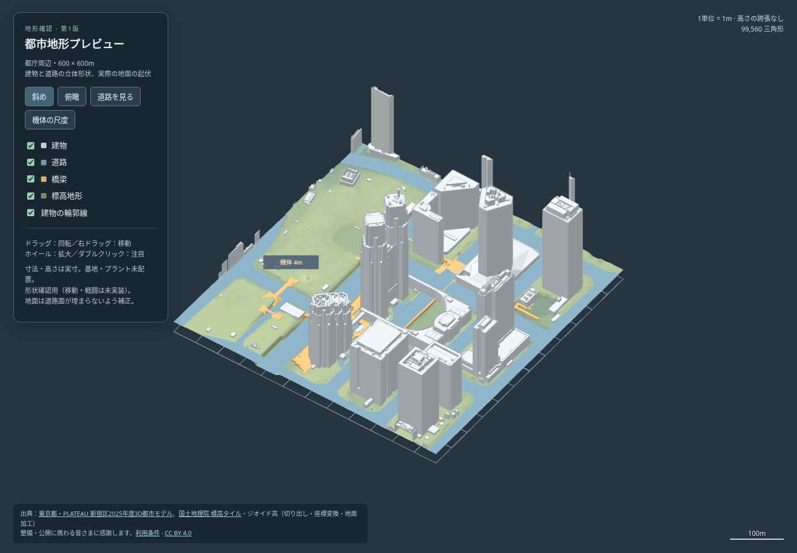

# PLATEAU 都市地形プレビュー（第1版）

2026-10-22、ユーザー指定の都庁周辺を、PLATEAUの実形状で600×600mに切り出した。[3Dプレビュー](preview.html) は単体HTMLで、保存してブラウザで開ける。インターネット接続やゲーム本体を要求しない。これは [段階確認](../WORKFLOW.md) の地形確認で、基地・プラント・経路・対戦ルールは未設定。



[俯瞰](top.png) / [道路・橋梁を見やすくした図](street.png)

## 表示と尺度

- 建物：新宿区2025年度モデル、LOD2・テクスチャなし。道路：LOD3。橋梁：LOD2。親タイルを子と重ねず、最詳細の54タイル（56メッシュ）から取得した。
- 地面：国土地理院の5m DEM（レーザ）`dem5a_png`、ズーム15の2タイルを使用。4m格子へ補間したもので、4mの測量精度を意味しない。元DEMの標高範囲は約27.69〜45.20m。
- 中心は東経139.6918度・北緯35.68975度、水平回転12度、1単位1m。WGS84のECEFを局所接平面へ変換する。従来OSM版と中心・回転・尺度を揃えるが、従来の球面換算と投影法が異なり端部に1m程度の差がありうる。
- 中心点の標高取得APIが返す35mを表示の高さ0とする。PLATEAUの楕円体高には国土地理院の中心点ジオイド高37.0995mを引く。600m街区では一定値として近似し、測量用の厳密な高さ変換とは扱わない。
- 地面の高さは誇張しない。DEMは橋の下と上を同時には持てないため、道路の下に隠れる地面を道路面の0.35m下へ下げる。4m格子の補間用に周囲1格子にも広げる。下げ幅は最大約7.70m、上方への変更はない。道路・橋梁の頂点自体は変えず、上下のメッシュを残す。これは表示用の加工であり、そのまま測量標高として再利用しない。
- 境界を横切る三角形は±300mで切る。建物を箱に置き換えず屋根形状を保つ。外周で切られた建物の断面には蓋を付けていない。
- オレンジ色の簡略機体は比較用のオリジナル形状で高さ4m。移動・戦闘・衝突判定を持たない。

左ドラッグで回転、右ドラッグ（またはShift＋ドラッグ）で移動、ホイールで拡大、ダブルクリックで注目。俯瞰・斜め・道路・機体の尺度の4ボタンと地物別表示切替がある。「道路を見る」は建物を隠す。ほかの視点ボタンは建物を再表示する。スマートフォンでは「表示設定」で操作パネルを開閉できる。

## 検証と限界

[形状検査](geometry-check.json) と [ブラウザ検査](browser-check.json)、[集計](summary.json) を保存した。

- 復号後の全56メッシュを、公開タイルの緯度・経度・楕円体高の範囲へ照合。高さの範囲外誤差は最大0.000019m未満で、軸変換やRTC中心の取り違えがないことを確認した。
- 全頂点が有限値、水平±300m以内。起伏を保持し、道路と橋梁には同じ平面座標の上下階を保持する。例：(165,-75)の床は相対高-2.00mと4.93m以上、(165,120)は0.03mと5.87m。これらは面の位置で、橋下面との有効な通行高ではない。
- 地形全体99,560三角形、確認機体などを含め99,646三角形。Chromiumで外部通信を禁止して起動し、4視点、4地物の表示切替、回転・拡大・平行移動、390×844表示を検査。外部通信0、ブラウザエラー0。
- 建物・道路・橋梁・DEMは測量年度や収録対象が異なる。すべての構造物・橋下面・取付部・階段の連続性は保証しない。4交差点すべての接続や機体の通行、屋根への到達、射線、Bot経路は次段階で確認する。見た目の上下関係を通行合格としない（[知識台帳](../LESSONS.md) M01/M02/M28）。
- ゲーム本体・既存OSMマップは変更しない。ユーザーの地形確認前なので基地・プラントを置かず、Bot戦とゲーム配布ZIPの作成も行わない。

## 再生成

Python 3（NumPy・Pillow・SciPy）、Node.js、コード用依存の `draco3d@1.5.7` を使用。例のキャッシュ・依存先はリポジトリの外に置く。

```sh
python3 -m pip install -r tools/plateau/requirements.txt
npm install --prefix /tmp/plateau-deps draco3d@1.5.7
python3 tools/plateau/fetch.py /tmp/plateau-cache
PLATEAU_DRACO_MODULE=/tmp/plateau-deps/node_modules/draco3d node tools/plateau/decode.cjs /tmp/plateau-cache
python3 tools/plateau/build.py /tmp/plateau-cache /tmp/plateau-preview
python3 tools/plateau/check.py /tmp/plateau-cache /tmp/plateau-preview
node tools/test/plateau_preview_check.cjs /tmp/plateau-preview/preview.html
```

最後のブラウザ検査はリポジトリ標準のPlaywrightとChromiumを使い、結果とスクリーンショットを出力先へ保存する。入力の取得記録は `inputs.json`。`fetch.py` はキャッシュがあれば再取得しない。今回固定した入力URL・バイト数・SHA-256は [source-manifest.json](source-manifest.json)。再取得で元データが更新された場合はこの記録と照合する。圧縮前のモデル約24MBや復号中間ファイルはコミットしない。

`build.py` の出力 `preview.html` と検査結果・選んだ図をこのフォルダへ写す。生成済みHTMLを手で編集しない。地理データとソフトウェアの出典・利用条件・謝辞は [CREDITS.md](CREDITS.md)。
