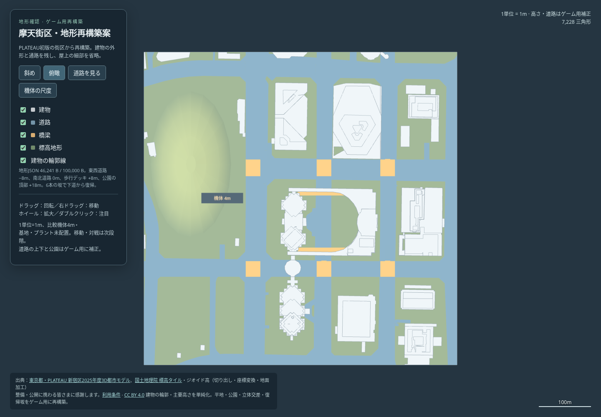

# 摩天街区・PLATEAUからの地形再構築

2026-10-23、ユーザー指定で旧OSM案をいったん廃案とし、新宿のPLATEAU初版から100KB以下のゲーム用地形を作り直した。[3Dプレビュー](preview.html) は保存して単独で開ける。初版は上書きしていない。



[斜めから](oblique.png) / [道路・デッキ](street.png) / [4m機体との比較](scale.png)

## 容量と形状

| 対象 | 実測 |
| --- | ---: |
| ゲーム用地形JSON全体（非圧縮・改行込み） | **46,241 B / 100,000 B** |
| 展開後の地形 | **7,228三角形** |
| PLATEAU初版 | 99,560三角形 |
| 体積形状 | 87個（建物79、道路・歩行デッキ8） |
| 確認用HTML（Three.js・操作UI・表示メッシュ込み） | 689,358 B |

600m四方・1単位1m、比較機体4m。建物の外形と主要な高さ・段差をPLATEAUから取り、細かな屋上小物・薄い張り出し・小屋を省略した。建物の79形状には同じ棟の上部を含む。隙間を先に埋める処理は使わず、道路を保護してから輪郭を単純化する。容量を合わせるために圧縮後の値を用いたり、データを100KBまで水増ししたりはしない。残りは今後のゲーム施設・経路用に使える。

## ゲーム用の地面と立体交差

- 一般の地面・南北道路を0m、東西の下道を-8m、庁舎と会議棟を結ぶ歩行デッキを+8mに整理した。
- 以前の現地指摘を基に道路の上下を補正した。下道2本×南北道路3本の6交差は、下道から橋下面まで6.5m。中央の下道は公園へ突き抜けさせず、西側の南北道路で止める。
- 下道から戻る坂を各3本、計6本設けた。幅10m、長さ33m、高低差8m。建物に重ならず、4m機体が収まる床・頭上を検査した。
- 公園は0→7→14→18mの連続した盛り土へ作り直した。道路を覆わないよう切り戻している。
- PLATEAUだけでは地下・デッキ・取付部の完全な接続は分からない。高さと幅はゲーム用の仮値で、現地地下構造の実測再現ではない。

## 確認したこと・次の段階

[形状検査](geometry-check.json) は量子化後のJSONを秋葉原と同じランタイムで展開し、下道の全線、6交差の上下の床と下面、6本の坂の床の連続性・幅・頭上、公園の頂部、座標範囲・有限性を確認する。地形データのハッシュは [生成記録](generation.json) に保存した。

[ブラウザ検査](browser-check.json) は外部通信を禁止して、4視点・4地物の切替、回転・拡大・平行移動、スマートフォン表示と4m機体の見え方を確認した。外部通信0、ブラウザエラー0。

今回は [段階確認の手順](../WORKFLOW.md) の**地形確認**。基地・プラント・カタパルト・Bot経路は置いていない。機体の実走、戦闘、勝率やFPSの確認も未実施。地形を確認後、基地位置→確認→プラント位置→Bot戦へ進む。ゲーム本体・通常マップ一覧・配布ZIPは変更していない。

## 再生成

```sh
python3 -m pip install -r tools/plateau/requirements-compact.txt
python3 tools/plateau/rebuild_shinjuku.py mapdesign/plateau_city mapdesign/shinjuku_rebuilt
node tools/test/shinjuku_rebuild_check.js mapdesign/shinjuku_rebuilt
node tools/test/plateau_preview_check.cjs mapdesign/shinjuku_rebuilt/preview.html
```

入力は [PLATEAU初版](../plateau_city/README.md) の保存済み頂点列。2026-10-22取得の54タイル・56メッシュとDEMを使い、旧OSM地形や路地を潰した版を入力にしない。取得URL・ハッシュ・利用条件は [元の取得記録](../plateau_city/source-manifest.json) と [CREDITS.md](CREDITS.md)。
