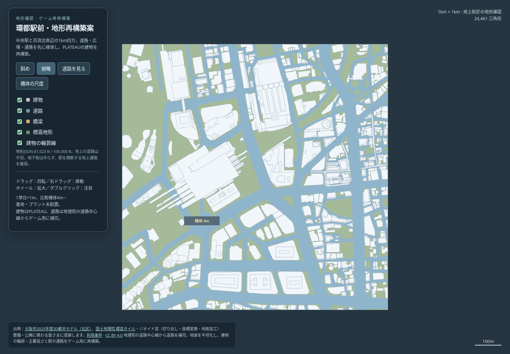

# 環都駅前・梅田1km四方の地形案

2026-10-23、ユーザー指定で新宿案を採用保留にし、大阪駅〜阪急・阪神百貨店周辺を **1km×1km・100KB以下** のゲーム用地形へ再構築した。[3Dプレビュー](preview.html) は単独で保存して開ける。



[斜めから](oblique.png) / [道路と通路](street.png) / [4m機体との比較](scale.png)

## 容量と範囲

| 対象 | 実測 |
| --- | ---: |
| 地形JSON全体（非圧縮・改行込み） | **81,023 B / 100,000 B** |
| ゲーム用形状を展開した面数 | 24,461三角形 |
| 内訳 | 建物22,650・道路1,809・地面2 |
| 建物の体積形状 | 641個（同じ棟の上部・段差を含む） |
| PLATEAUの取得 | 建物9タイル・9メッシュ |
| 確認用HTML（Three.js・操作UI・表示形状込み） | 869,582 B |

中心は東経135.4977度・北緯34.7024度、北が上。1単位1m、水平±500mで切り出し、4mの簡略機体を比較表示する。PLATEAUの建物の位置・外形・主要な高さを使い、屋上小物・小屋・薄い張り出しを省略する。面積のある上部は残して、大きな駅舎・百貨店・高層棟を一つの箱にしない。

100KB制限の対象はゲーム用 `layout.json` 全体。モデルの輪郭・高さ・地面・道路・出典を含む非圧縮値で、確認用の共通ライブラリや研究記録は含まない。1km幅を保存できる2cm格子を使い、量子化後のJSONを実際のJavaScriptで展開した同じ形状をプレビューにも表示する。

1km形式の読み込みは試作用の共通ランタイムへ実装済み。通常本体へ登録するときには、この座標刻みと面データの検査への対応も反映する。

## 地形の方針

- 地上の街区を対象にし、地面は0mの一平面、舗装の表示は+0.04mにそろえる。地下街は作らない。
- PLATEAUの詳細道路・橋梁は前回の収録確認でこの周辺に揃わなかったため、国土地理院の道路中心線から道路を補完した。幅情報を使い、ゲーム用の通路は最低8m＋左右1mの余白を確保する。トンネル・地下・自動車専用の線は地上道路に混ぜない。
- 道路・広場・駅を横断する通路を先に保護し、その後に建物を単純化する。建物間の路地を最初に埋める処理は行わない。
- 中央駅の大きな建物で南北が分断されないよう、幅14mの横断通路を1本設ける。上部の形は残し、通路上の建物は8m以上の高さからにする。駅南北の広場もゲーム用に整理した。
- 地理院の道路中心線は収録時期が異なるため、現地の再開発・店舗内・地下通路・改札・歩行デッキの完全再現ではない。道路と通路の幅・高さはゲーム用の補正値。

## 確認したこと・次の段階

- [元データの形状検査](source-check.json)：9メッシュを公開3D Tilesの緯度・経度・高さの範囲へ独立に照合。座標変換・有限値・1km範囲を確認。道路・橋梁レイヤーが空であることを明記して検査する。
- [ゲーム用形状の検査](geometry-check.json)：量子化後のJSONを共通ランタイムで読み、道路391点に4m機体が収まること、駅横断通路148点の幅・頭上・接触を確認。床と体積を調べた10m格子では5,665点がつながり、四方の街区へ到達する。
- [ブラウザ検査](browser-check.json)：外部通信を禁止して起動し、4視点・4レイヤー、回転・拡大・平行移動、スマートフォン表示、4m機体の視認を確認。外部通信0・ブラウザエラー0。
- 従来の1cm格子の都市データも読み込めることを確認。ゲーム本体・通常マップ一覧・既存の地形データ・配布ZIPは変更していない。

今回は [段階確認の手順](../WORKFLOW.md) の**地形確認**。基地・プラント・Bot経路は未配置で、機体の実走・対戦・FPS・勝率は未検証。地形確認→基地位置→確認→プラント位置→Bot戦の順に進む。

## 再生成

```sh
python3 -m pip install -r tools/plateau/requirements-compact.txt
npm install --prefix /tmp/plateau-deps draco3d@1.5.7
python3 tools/plateau/fetch.py /tmp/umeda-cache --config research/maps/umeda-sources.json
PLATEAU_DRACO_MODULE=/tmp/plateau-deps/node_modules/draco3d node tools/plateau/decode.cjs /tmp/umeda-cache
python3 tools/plateau/build.py /tmp/umeda-cache /tmp/umeda-source
python3 tools/plateau/check.py /tmp/umeda-cache /tmp/umeda-source --allow-empty-layers tran brid
python3 tools/plateau/rebuild_umeda.py /tmp/umeda-cache /tmp/umeda-source mapdesign/umeda_rebuilt
node tools/test/umeda_rebuild_check.js mapdesign/umeda_rebuilt
node tools/test/plateau_preview_check.cjs mapdesign/umeda_rebuilt/preview.html
```

取得URL・ハッシュ・元データの不在レイヤーは [source-manifest.json](source-manifest.json) と [source-check.json](source-check.json)。生成の設定・容量・ハッシュは [generation.json](generation.json)、原出典と加工内容・利用条件・謝辞は [CREDITS.md](CREDITS.md)。以前の梅田調査で保存した建物6タイルを再利用し、1km範囲に必要な3タイルを追加取得した。大きい復号中間ファイルや圧縮前モデルはコミットしない。
