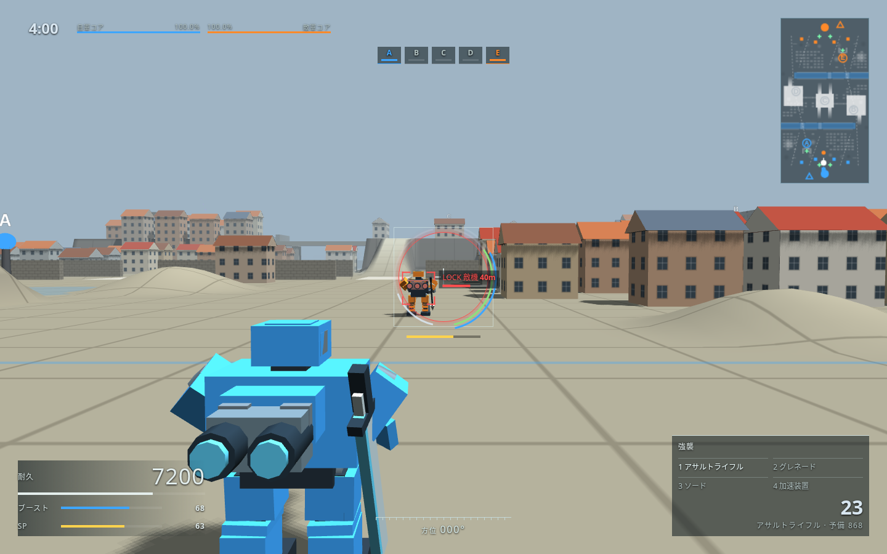
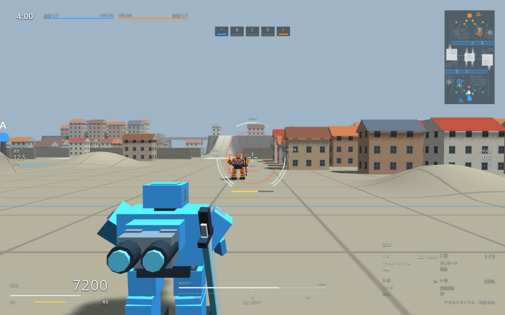

# メカニカルHUDの追加調整

参照：[SAMURAI GAMERS「画面の見方とUI表示の意味」](https://jp.samurai-gamers.com/armoredcore6/armoredcore6-screen/)（オーナー指定、2026-10-20）。参考画像は取り込まず、本作の図形とゲーム内の値で描いた。

変更前は main の `3afaa37`、変更後は本PR。同じ市街地・機体・敵・視点で比較。耐久7200、ブースト68%、SP63%、主武器23発、速度12.5m/s、敵耐久62%・距離40m。比較用に試合の進行と乱数を固定し、HUDと3D画面は実際の描画処理を使う。

| 変更前（1440×900） | 変更後（1440×900） |
|---|---|
|  |  |

- [640×480](compact.png)：右下の4枠と下中央のブースト・方位が重ならない。
- [640×480・被ロックオンとベース侵入](warnings.png)：左上に警告を並べ、敵耐久の上を空ける。短い画面では速度計より警告を優先。
- [光波剣65%充填](charge.png)：補助枠と照準の充填メーターが追従。
- [狙撃スコープ](scope.png)：中央の弧と飛行計器を隠し、SPと下中央のブーストは残す。

照準の内側は左が主武器・右が副武器、外側は左が補助・右が特別装備。再装填・冷却は復帰の進み具合、特別装備はSP残量。既存のロック判定の円は同じ大きさを保つ。

確認：`console_hud_check.js`（4種類の切り替え・保存、359項目・32通りの配置）、`mechanical_hud_check.js`（実射・再装填・充填・冷却・SP消費と回復・対象情報・スコープ・再出撃など25項目、4解像度の配置）、`quick_check.js origin/main`（city・dockのBot戦を含む）。ブラウザのエラーなし。
