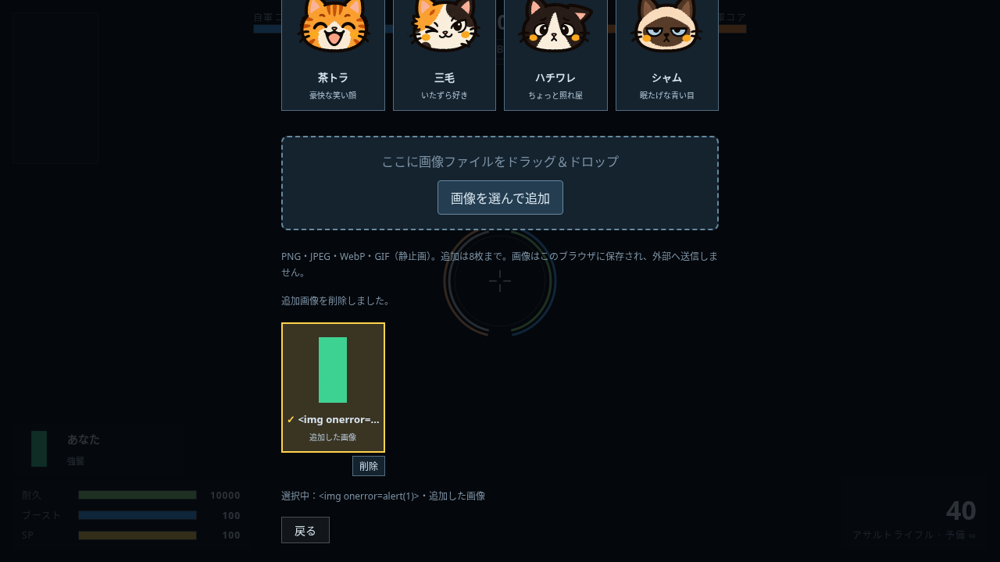

# 追加パイロット画像

ユーザー指定（2026-10-23）：パイロット画面へ画像ファイルをドラッグ＆ドロップして、自分のパイロットとして使う。クリックからのファイル選択も使える。

## 使い方

1. メニューの「パイロット」を開く。
2. 枠へ画像をドロップするか「画像を選んで追加」を押す。複数ファイルも追加できる。
3. 追加したカードを選ぶと、自分のHUD・スコア表・結果の顔が替わる。
4. 不要なカードの「削除」で取り除く。元の画像ファイルは削除しない。

猫8匹は残る。追加画像は最大8枚、PNG・JPEG・WebP・GIF（静止画）に対応。縦横比と透過を保ち、384px以下の正方形へ余白を付けて収める。小さい画像は不必要に大きな余白を付けず、その大きさで保存する。

画像はブラウザ内で処理し、サーバーへ送らない。同じHTML・ブラウザでの再読み込み後にも復元する。`file://` の保存範囲はブラウザに依存し、別の場所へ展開したHTMLや別ブラウザへ自動で画像を移すものではない。保存できない環境でも起動中は使え、その旨を画面に表示する。

## 実装

既存の `coreBreakerPilot` の猫IDは維持し、追加画像には `custom-…` の独立IDを割り当てる。画像一覧は `coreBreakerPilotImages` に保存する。既存の装備・機体・コンソールの保存形式は変えない。

元ファイルは1枚16MB以下、3200万画素以下。実データのヘッダーを確認して画像を復号し、1枚18万文字以下のWebP（非対応ならPNG）データURLへ変換する。SVG・HTML・外部URLは取り込まない。ファイル名は表示用の文字として扱い、保存から戻したID・データURLも検証する。一時オブジェクトURLは成功・失敗とも解放する。

追加画像のCSSは共有し、スコア表の各行や毎回の描画にbase64を複製しない。Botは従来の猫8匹を使い、ゲームの乱数・性能・人数は変えない。追加した画像素材はリポジトリに同梱しない。確認用画像は試験で作成した単純な色と透過の図。

## 確認

```sh
python3 tools/test/make_dbg.py dbg
node tools/test/custom_pilots_check.js dbg media/custom-pilots
node tools/test/pilot_avatars_check.js dbg media/custom-pilots/cat-regression.json
node tools/test/player_profile_check.js dbg media/custom-pilots/profile-regression
node tools/test/quick_check.js origin/main 60
```

- [追加画像の25項目](custom-validation.json)：実ドロップ、ファイル選択、再読み込み、選択・非選択画像の削除、縦横比と透過、4コンソール・スコア表・再出撃、人数と装備の維持、乱数不使用、SVG・破損・過大ファイル拒否、GIF、上限、壊れた保存値、保存不可時と一時URL解放。
- [猫の68項目・16配置](cat-regression.json)：既存の8匹とキルカメラ・保存・全コンソールの互換性。
- [名前と配置の75項目](profile-regression/validation.json)：名前入力・保存・日本語変換とアーケードHUD。
- 簡易検査で既存294武器・72パーツ・7マップの増減変更なし。city・dockのBot戦を含めてブラウザエラーなし。


