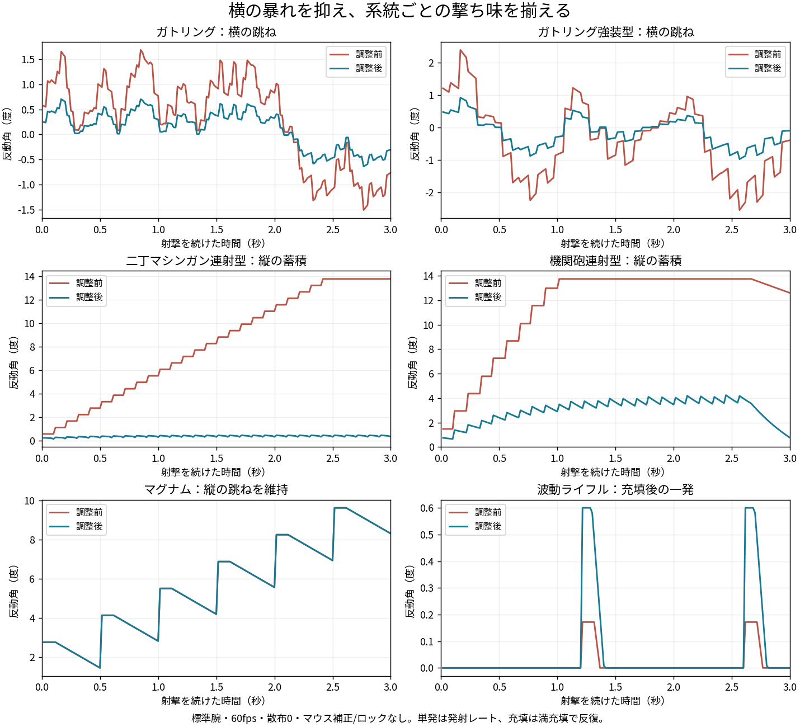

# 主武器の反動調整の実射比較

比較前は`cf23419`。標準腕・60fps・散布0・乱数7169・ロックとマウス補正なし。ガトリングは回転済みから3秒。他の系統も3秒間、単発銃は発射レート、充填銃は満充填ごとに撃つ。本体の`weaponsTick`/`shot`/`updateCamera`を通す。

`family_recoil_check.js`は338項目、100主武器・28系統と64ケースの実射を確認する。全ケースで弾の消費数を維持。ガトリング基本型は75発を維持し、横の角度の振幅を約58%、1フレームの最大視点変化を約54%軽減。マグナムの基本型は縦の経過を完全に維持し、発射後の横の角度を半分にする。詳しい数値は`summary.json`。

充填系は控えめすぎた跳ねを系統ごとに付け、低レートの連射銃は長く撃ったときの蓄積を抑える。全系統を一律に弱くする調整とは異なるため、系統・型別の採用値は[調整記録](../../research/weapons/primary-recoil-tuning.md)を参照。

`primary_recoil_check.js`は250項目と8実射ケース、`soft_recoil_check.js`は47項目と18実射ケースで採用値/腕部/レート補正/カスタマイズ/時間刻みを確認。`camera_recoil_check.js`は531項目で4HUD・8武器・距離/画角と照準/実射線の一致を確認する。固定条件の試験であり、対戦バランスと好みの最終評価は実プレイで行う。
