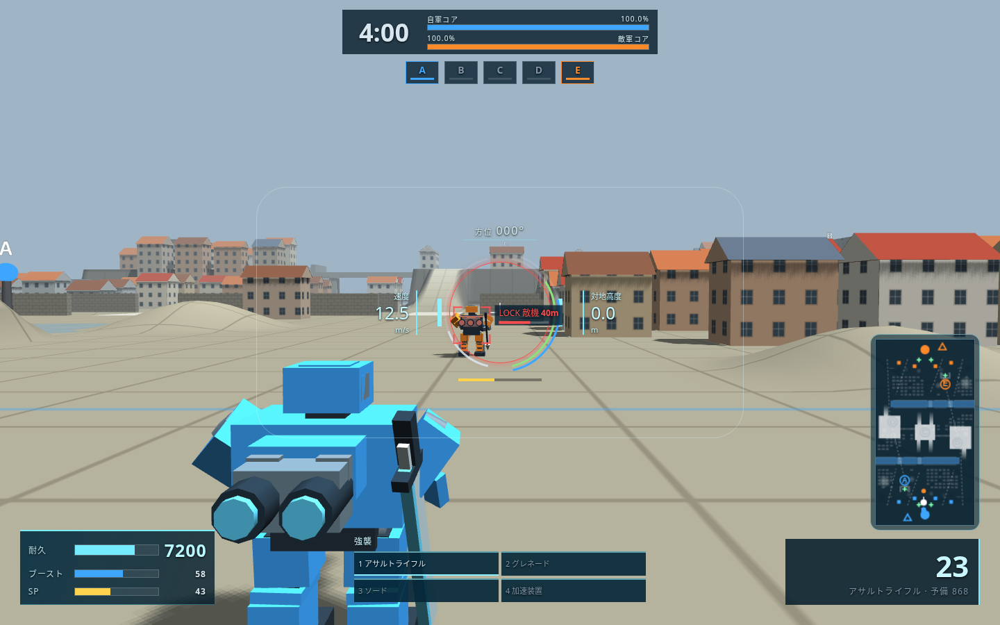
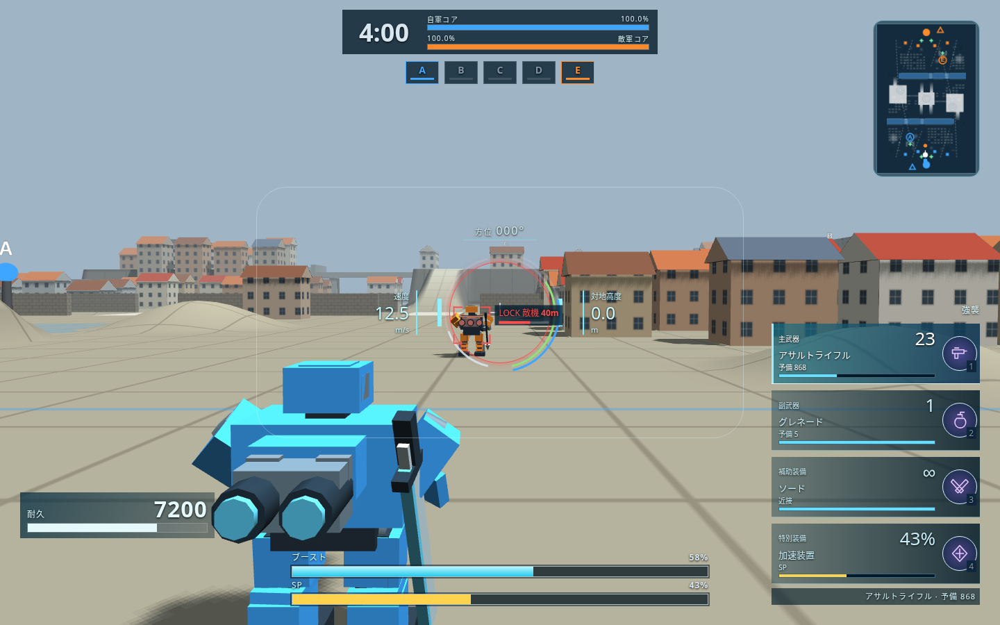

# フライトの下中央ゲージと縦型装備欄

オーナーが添付した星の翼のプレイ画像（2026-10-20）を参考に、フライトのブースト・SPを下中央の大きな上下2本、装備4枠を右側の縦表示に変更した。装備の印は本作のSVG図形。

変更前は main の `3afaa37`。市街地の同じ機体・敵・視点を固定して比較。耐久7200、ブースト58%、SP43%、主武器23発、速度12.5m/s、敵耐久62%・距離40m。試合の進行と乱数を固定し、HUD・3D画面は実際の描画処理を使用。

| 変更前（1440×900） | 変更後（1440×900） |
|---|---|
|  |  |

- [640×480・警告あり](compact.png)：被索敵・被ロックオン・ベース侵入と長い武器説明を出した状態。右側の縦4枠と下中央の2本を維持する。
- [迷彩作動と再装填](active.png)：下のSPと特別装備欄が実際の消費に追従し、主武器欄に再装填を表示。
- [狙撃スコープ](scope.png)：ブースト・SPの2本と4枠の装備は暗幕の上でも読める。

確認：`flight_hud_check.js`（実際のダッシュと回復・射撃・腕倍率付き装填・光波剣充填・杭の冷却・迷彩SP・表示切り替えなど20項目、2マップ×6解像度）、`console_hud_check.js`（359項目・32通りの配置）、`quick_check.js origin/main`（city・dockのBot戦を含む）。JavaScript構文確認・`git diff --check` 成功、ブラウザのエラーなし。
