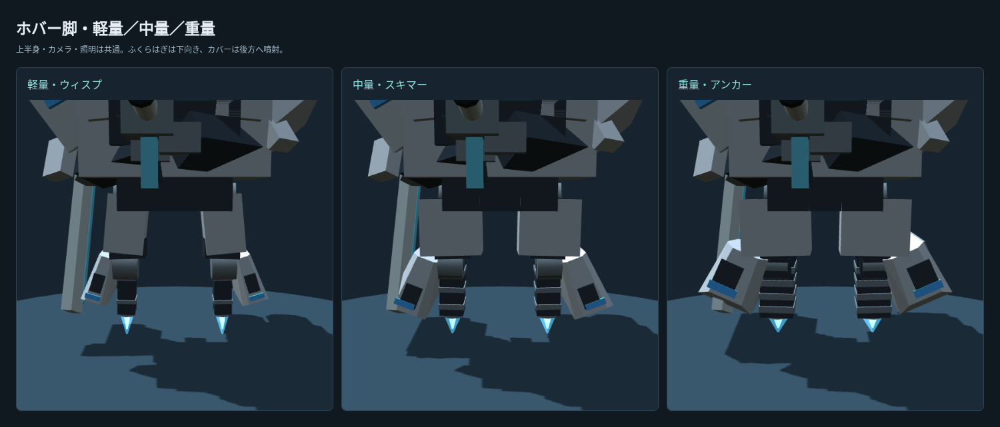

# ホバー脚モデルの差し替え

軽量ウィスプ、中量スキマー、重量アンカーの各4型に、比較試作で選んだモデルを適用する。長いふくらはぎ型ブースター2本と、外側にハの字に開いて後ろへ伸びるカバーを持つ。ふくらはぎは下向き、カバー後端は後方へ噴射する。

`accepted.json` は標準の上半身・ash塗装・シアンで生成した、承認済み比較試作の装甲rest位置／法線／色と噴射rest位置のSHA-256。`hover_models_check.js` がゲーム本体の生成結果と比較する。画像・頂点データとも本作のコードで生成しており、公式の画像やモデル素材は取り込んでいない。

被弾範囲は差し替え前を維持する。新しいカバーは見た目として後ろへ伸びるが、その分だけ脚の被弾範囲を広げない。脚のレイ判定には同じ骨で更新した従来形状を使うため、表示と被弾の形状は異なる。表示は4装甲メッシュ・共通材質1つ、炎は1メッシュ。

検証の集計は `validation.json`。36構成×8姿勢の表示・被弾・噴射停止、二脚18型、全6561混成、全302武器、既存ホバーの性能・水面・保存、4マップのBOT戦を確認した。dockはコア破壊で91秒に終戦し、ほかの3マップは150秒以上を進めた。

CPUの武器・姿勢・頂点更新だけを同一入力で比較した参考値は、20機で中央値0.4→0.6ms、100機で2.0→3.5ms。旧形状の被弾用頂点も更新するため、CPU負荷は増える。これは描画・GPU・BOT思考・物理を含むフレーム全体の測定ではなく、実GPUのFPS同等性は未検証。
