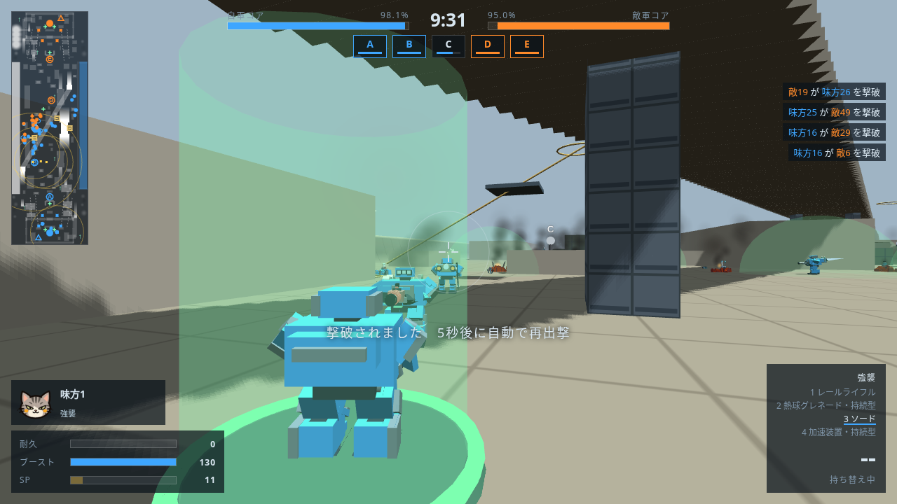

# 潮路搬送区・50対50実験

2026-10-20、ユーザー依頼。潮路搬送区の3配置で、あなた＋味方Bot49機 対 敵Bot50機を試せるようにした。

## 試し方

1. マップ選択で「潮路搬送区」の屈折前線・上層干渉・複路争奪のいずれかを選ぶ。
2. 最初の画面へ戻り「50対50（実験）」をONにして出撃する。
3. スコアはTabを押して表示。Tabを押したままホイールを回すと下位まで読める。
4. 通常人数へ戻すときは、次の出撃前にOFFにする。ほかのマップへの変更とページの再読み込みでも通常人数へ戻る。

[最初の画面](integrated/menu.png)／[スコア上部](integrated/scoreboard-top.png)／[50位までのスコア](integrated/scoreboard-bottom.png)

## 実装の範囲

マップデータの `team: 10` は維持し、実験を選んだ試合の生成人数だけ50へ切り替える。兵装・役割の10機ぶんの並びを5回繰り返す。地形・施設・戦闘・占拠・コアの減少・試合時間の規則は通常と共通。実験の選択は保存しない。

スコア表と結果画面は全100機を表示する。Tab表示中のホイールをスクロールへ回し、武器の持ち替えを防ぐ。ピクセル・行・ページ単位の入力に対応する。

## 120秒のBot戦

シード20261020。全機Botとして本体のAI・移動・射撃・拠点・再出撃をゲーム内120秒進めた。描画は行列更新に置き換え、1フレームのゲーム処理を測定した。各ケース1試合で、勝率の比較は行っていない。

| 配置 | 人数 | 撃破 | CPU中央値 | CPU 95%点 |
|---|---:|---:|---:|---:|
| 屈折前線・通常 | 10対10 | 39 | 4.3ms | 11.4ms |
| 屈折前線・実験 | 50対50 | 213 | 24.4ms | 52.4ms |
| 上層干渉・実験 | 50対50 | 204 | 22.4ms | 45.4ms |
| 複路争奪・実験 | 50対50 | 211 | 23.6ms | 50.1ms |

100機の状態は有限値を維持し、各配置で99機が初期位置から10m以上移動した。全試合ブラウザエラーなし。[結果と拠点・コアの残量](full-120s/battles.json)／[26項目の確認](full-120s/validation.json)／[ログ](full-120s/check.log)。

この120秒の測定はHUD修正PR #27の取り込み前の `1ce6c36` で実施した。取り込み後もAI・物理・戦闘・進行の対象11関数が同じであることを照合し、最新版で次の確認を行った。[対象ソースの記録](source-manifest.json)。

## 最新mainを取り込んだ後の確認

- `python3 tools/test/make_dbg.py dbg/large-battle-integrated`
- `node tools/test/large_battle_check.js dbg/large-battle-integrated media/large-battle/integrated 30 --smoke`：22項目と50対50の30秒、成功。[結果](integrated/validation.json)／[ログ](integrated-check.log)。画面の切り替え、小画面、100機の編成・スコア・結果、武器を替えずにスクロール、OFF・マップ変更・再読み込み、旧機体の被弾対象の除去を確認した。
- `node tools/test/quick_check.js origin/main`：成功。武器286種・パーツ・マップの増減変更なし。city62秒、dock41秒で戦力0の正常終局。[ログ](quick-check.log)。
- 1280×720で本体の3D画面を描画し、スコアの50位、出撃前の切り替えを目視確認。描画の時間・描画回数・三角形数・使用レンダラーは [記録](integrated/battles.json) に含める。画像は生存している味方Botの視点へカメラを置いた観測画面で、HUDは試験のプレイヤー役（味方1）の状態を示す。

描画検査はこのクラウド環境のSwiftShaderを使う。上表のCPU処理時間に加えて描画の負荷もあるため、操作時の速度は遊ぶ端末で確認する。

## 次に観察すること

- 通常人数の約5〜6倍のCPU処理時間になった。重いフレームを処理区間ごとに測り、経路探索・機体の姿勢更新・射線計算のどこを減らすか決める。
- 同じ撃破ペナルティのまま、屈折前線のコア残量は2分で青約33%・橙約38%まで減った。増えた撃破数に対する試合の長さを測る。
- 守備役も陣営ごとに2→10機となり、同じ2警戒地点へ割り当てられる。基地への入り方と、守備の密集を観察する。
- 今回の3試合では中央Cはすべて橙が保持した。中央までの到達時間と前線の位置を、編成・陣営を入れ替えた試験で測る。
