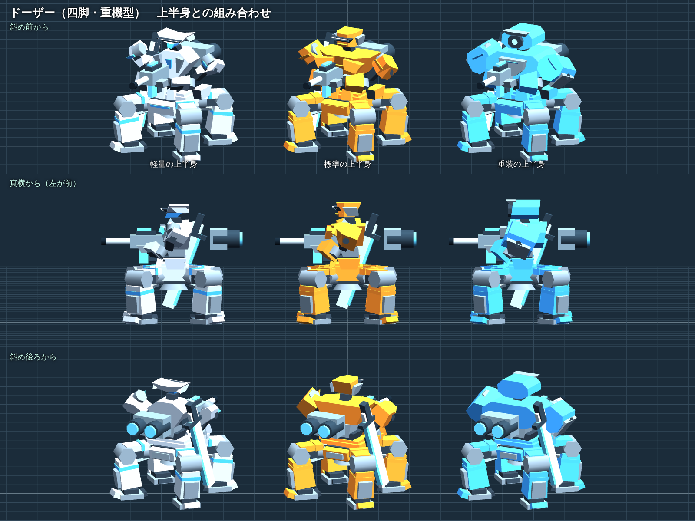
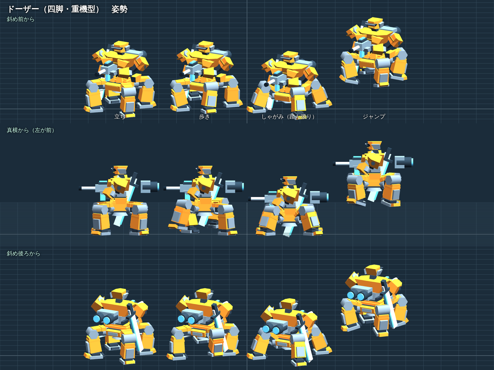
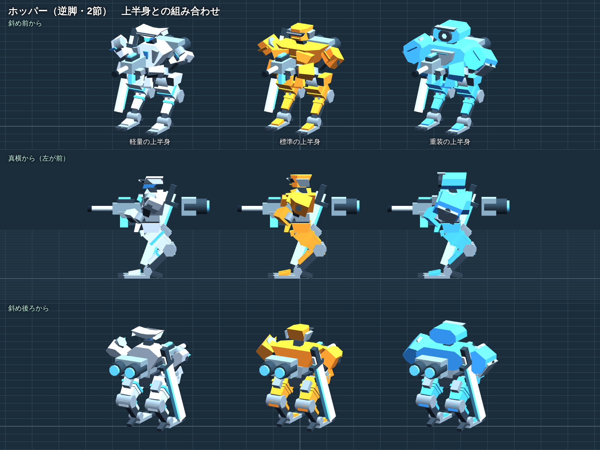
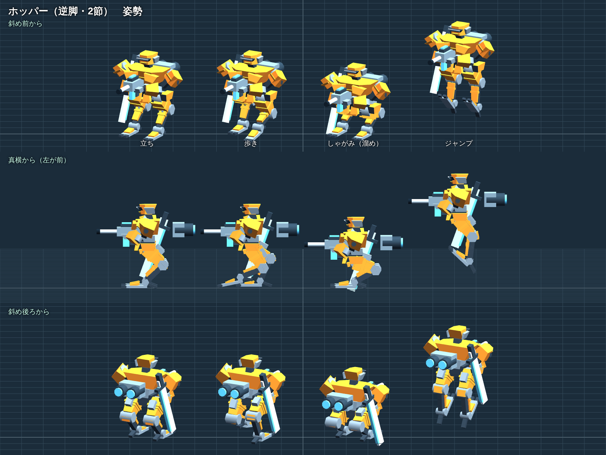

# 四脚・逆脚の形（#227）

今の機体の上半身（軽量・標準・重装）に、脚だけ付け替えて描いた絵と、その形を定義したコード。ゲーム本体（`buildMech`）にはまだ入れていない（入れるのは #228）。形はコードで組んだ箱と円柱で、公式や他作品の素材は使っていない。

## 仕上げた形（オーナーの決定 2026-11-11：四脚は B案、逆脚は A案）

| 脚 | 上半身との組み合わせ | 姿勢（立ち・歩き・しゃがみ・ジャンプ） |
|---|---|---|
| ドーザー（四脚・重機型） |  |  |
| ホッパー（逆脚・2節） |  |  |

- 形の定義は `leg_shapes.js`（`LEG_SHAPES.quad`・`LEG_SHAPES.reverse`）。関節の位置（付け根 → 膝 → 足首）から箱を張り、膝は2節の IK で決めるので、姿勢を変えても同じ部品で組める。#228 で骨に付けて動かすときの元になる。
- 四脚のしゃがみは「踏ん張り」（足を外へ広げて胴を落とす）、逆脚のしゃがみは「溜め」（深く畳む）。腰が下がる量は今のしゃがみと同じ 0.6m。
- 数（`shapes.json`）：脚の三角形は 四脚 900、逆脚 564（今の二脚 312、ホバー 544〜592）。四脚は脚が4本あるのでホバーの約1.6倍。脚の横幅の半分は 四脚 1.67m（踏ん張りで 1.95m）、逆脚 0.93m。
- まだの所：歩きなどの動き（絵は止めた姿勢）、当たり判定、背中の剣と脚の重なり（四脚の後ろ、逆脚の膝）。#228 で決める。
- 絵は真横と斜めを平行投影で描いている（機体の大きさを比べやすいように）。

作り直し方：

```sh
python3 media/legs-proto/patch_index.py /tmp/legs/index.html     # 写しに差し込み口（window.__legProto）を入れる
python3 tools/test/make_dbg.py /tmp/legs/dbg --src /tmp/legs/index.html
node media/legs-proto/cap2.js /tmp/legs/dbg                       # 4枚の絵と shapes.json
```

## 最初の下描き（2026-11-10、4案）

| 案 | 絵 | オーナーの決定（2026-11-11） |
|---|---|---|
| 四脚 A（蜘蛛型：高い膝を外へ張り出す細めの脚） | `quadA.png` | 今回は使わない。後で足す**軽量の四脚**に回す |
| 四脚 B（重機型：低い胴から太い柱の脚） | `quadB.png` | **今回の四脚に採択** → ドーザー |
| 逆脚 A（太い腿が後ろへ曲がる2節の脚） | `revA.png` | **今回の逆脚に採択** → ホッパー |
| 逆脚 B（鳥の脚の形の3節の脚） | `revB.png` | 今回は使わない。後で足す**中量の逆脚**に回す |

下描きの定義は `cap.js` の `__PROTO`（`node media/legs-proto/cap.js`、`dbg/` は `cap.js` と同じフォルダに作る）。前は −z。
