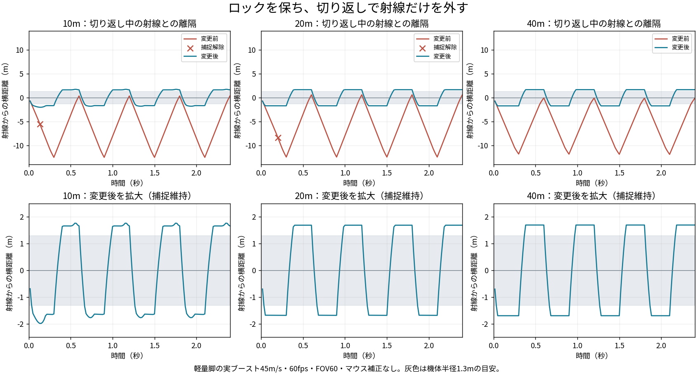

# ロック維持と遅れのある視点追従の確認

2026-10-22。比較前は`ec45c7c`。調整済みの主武器反動を保ち、プレイヤーの視点追従と捕捉の保持だけを変更する。

実際の`shortDash`/`physics`で軽量脚の敵を45m/sで動かし、2.4秒間に左右7～8回切り返す。10/20/40m、30/60/144fps、FOV60/100の18ケース。射線から敵への最短の横距離を測り、斜め向きの射線を固定のZ平面へ投影するだけの誤差と分ける。

旧版は10/20mで全ケース捕捉が切れ、40mでは捕捉が残っても射線から約12mまで離れた。変更後は18ケースすべて捕捉を保ち、最大離隔は約1.7～2.0m。通常8m/sの横移動は30/60/144fpsとも体幅内を追い、ずれが積み上がらない。停止後は移動由来の遅れを詰める。

20m/60fps/FOV60では、反動と散布を0にした試験用スロットから実際の`shot`も呼び、ブースト中に33射が外れ、停止後に命中することを確認した。製品の武器性能は変えない。

`recoil_lock_check.js`は126項目。手動の縦横入力と反動の維持、自機のブースト、±πの境界、旋回上限、保持範囲外の猶予、射程/撃破/迷彩/妨害/装備/遮蔽による解除も含む。`camera_recoil_check.js`は531項目で4HUD・8武器・距離/画角、照準と実射線の一致を確認。`secondary_lock_hud_check.js`は687項目で副武器/ミサイルの従来の動作を確認。いずれもブラウザエラー0。

今回の変更には`quick_check.js origin/main`（主武器100種とcity/dock各60秒）も実行。射撃やBotの本体処理、武器性能は変更せず、前回の全294装備・4マップ試験からの追加として、今回の視点追従を実ブーストと実射で確かめた。元の採用値・仕様は[調整記録](../../research/lock-follow-lag.md)を参照。
