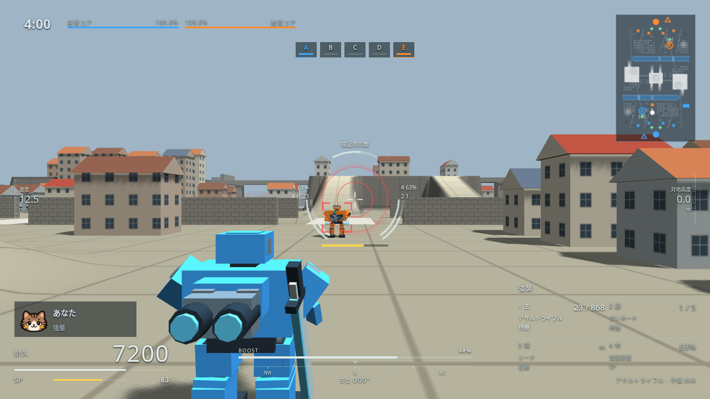
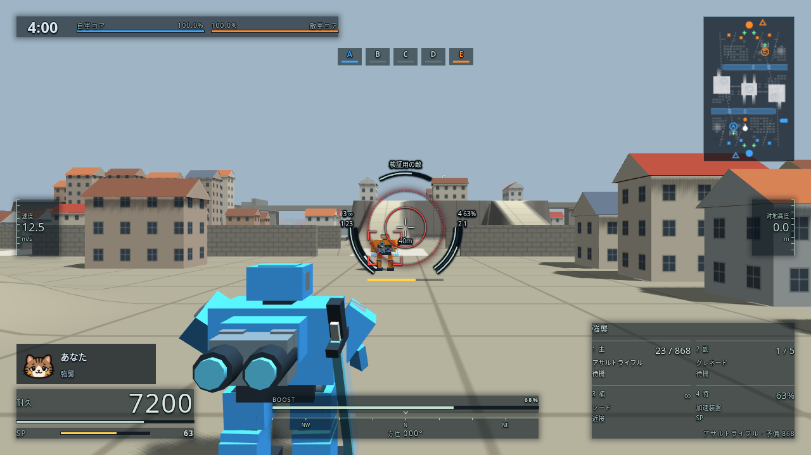
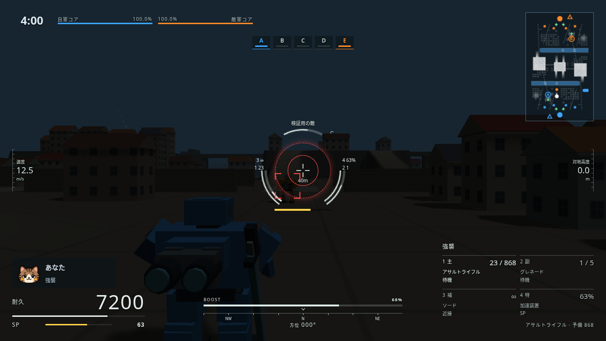
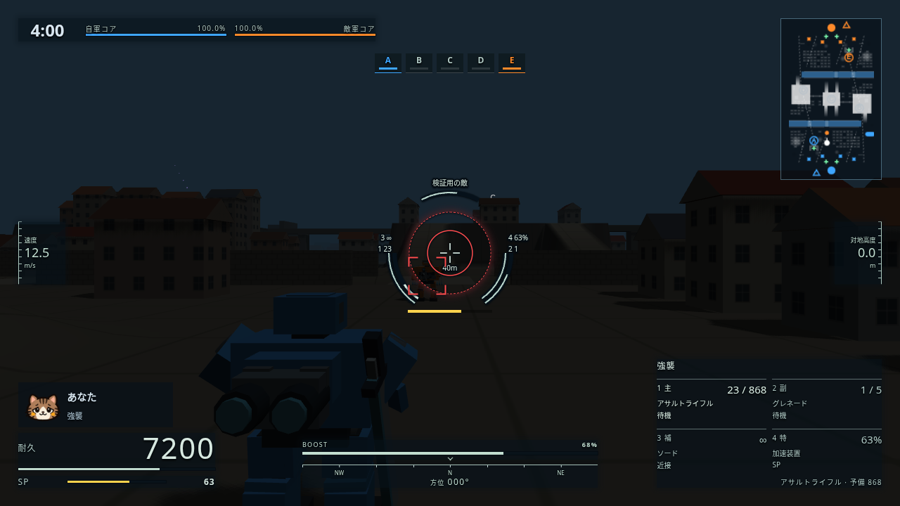
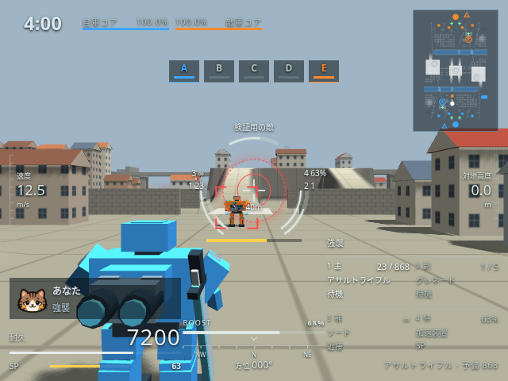
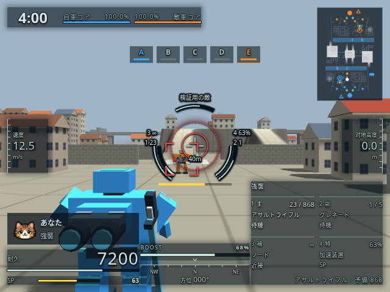

# 明るい地形でも読めるメカニカルHUD

2026-10-20、ユーザー依頼「アーマードコア風HUD白すぎてめっちゃ視認性悪いね」。

細い白線と弱い文字の影だけでは、空や明るい路面と重なったときに残量・弾数・目盛りを読み取りにくかった。通常の計器を淡い緑へ寄せ、選択中の武器を明るく太くした。照準のメーターは暗いレールの上に残量を描き、文字と照準には暗い輪郭を付けた。画面端の数値欄は半透明の暗い下地で支える。

今回の本体の差分はCSSのみ。警告の赤、再装填の青、充填・作動の緑と、計器の位置・ゲーム内の値は維持する。

| 条件 | 変更前 | 変更後 |
|---|---|---|
| 市街地・1280×720 |  |  |
| 暗い背景・1280×720 |  |  |
| 市街地・640×480 |  |  |

- [再装填中](reload-after.png)：選択中の主武器も青を維持する。
- [耐久低下・ブースト回復待ち](warning-after.png)：赤い警告色を維持する。

変更前は `3cf8633`。同じ市街地・乱数シード1831・機体・視点・数値を固定し、本体の描画を撮影した。プレイヤーは市街地の (-18, 175)、本体の肩越しカメラを使う。通常の耐久7200、主武器23発、SP63%、ブースト68%、速度12.5m/s。対象は40m先・耐久62%。暗い背景は視認性検査用に同じ場面の光源強度を12%にし、背景と霧を暗くしたもの（夜間モードの追加ではない）。元のゲームの画像素材は追加していない。

状態と色は [変更前](capture-before.json)／[変更後](capture-after.json)、対象ソースのSHA-256は [source-manifest.json](source-manifest.json) に記録。

## 確認

`python3 tools/test/make_dbg.py dbg/mechanical-contrast` の後に実行。

- `node tools/test/mechanical_hud_check.js dbg/mechanical-contrast media/mechanical-contrast/mechanical-validation.json`：25項目・4解像度。実射・再装填・充填・冷却・SP・対象情報・スコープ・再出撃、配置が成功。[ログ](mechanical-check.log)／[結果](mechanical-validation.json)。
- `node tools/test/console_hud_check.js dbg/mechanical-contrast media/mechanical-contrast/console-validation.json`：359項目・32配置、成功。[ログ](console-check.log)／[結果](console-validation.json)。初回の並列実行では city/640×480/arcade のミニマップ位置判定が失敗し、単独で再実行して全項目が成功した。[初回ログ](console-check-initial.log)。
- `node tools/test/player_profile_check.js dbg/mechanical-contrast dbg/mechanical-contrast/profile`：猫の透過・名前入力など既存75項目・16配置、成功。[ログ](profile-check.log)／[結果](profile-validation.json)。
- `node tools/test/quick_check.js origin/main`：成功。武器286種・パーツ・マップの増減変更なし。cityは60秒、dockは26秒で戦力0の正常終局。[ログ](quick-check.log)。
- すべてブラウザエラーなし。比較画像でも明暗と640×480を目視確認。

今後のHUD調整でも、白い線を足すだけで済ませず、明るい背景との境界・残量と空の部分の違い・警告色の優先度を確認する。
