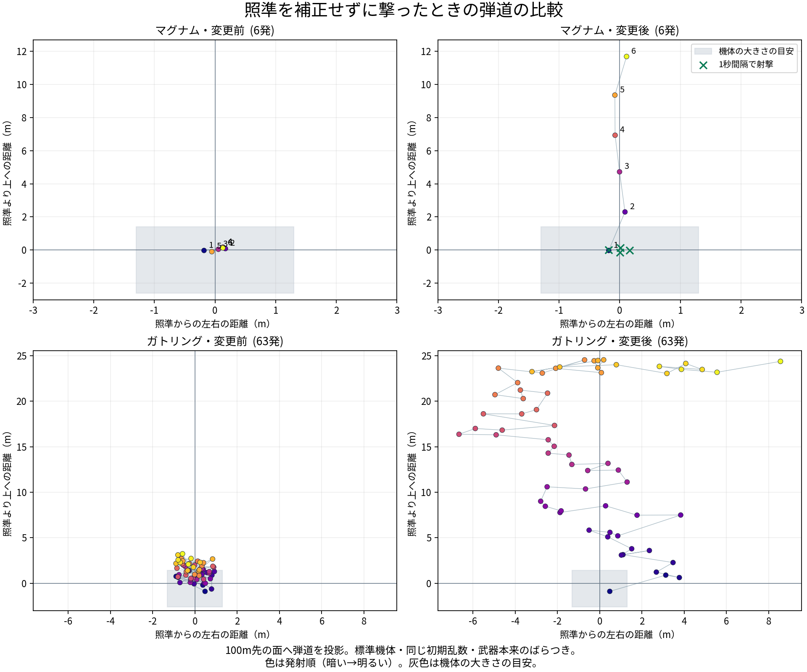

# 主武器の反動・実射比較

2026-10-20、ユーザー依頼。主武器100種に縦・横の反動を設定し、視点・銃の構え・実際の弾道へ反映する。ロック中の追従で反動を消さず、同じフレームの連射にも次の反動を反映する。



[SVG版](comparison.svg)／[実射データ](shots.json)／[縦横反動の比較画面](customization.png)

## 比較の条件と結果

変更前は `d8ce280`。両方とも標準機体・静止・乱数シード7169で、本体の `weaponsTick` → `shot` → `fire` を使った。武器本来のばらつきを維持し、手で照準を補正せず最高の発射間隔で撃つ。弾道のエフェクトが保持する実際の始点と終点から、100m先の面との交点を求めた。命中した物体の位置とは区別し、図は100mの面への弾道の投影とする。

| ケース | 変更前の最大縦反動 | 変更後の最大縦反動 | 100m面での左右の幅（前→後） |
|---|---:|---:|---:|
| マグナム・2.5秒/6発 | 0.69° | 9.66° | 0.35→0.29m |
| マグナム・1秒間隔/4発 | 0.69° | 2.75° | 0.37→0.35m |
| ガトリング・3秒/63発 | 1.56° | 13.75° | 1.82→15.21m |

マグナムの横反動は次弾までにほぼ回復する。連打時に残る縦反動と、間隔を空けたときの安定を確認した。ガトリングは上限までの縦の上昇と、連射中の左右の暴れを確認した。

設定値と出典：[採用記録](../../research/weapons/primary-recoil.md)。AC実数44種、本作のマグナム基準1種、残り55種は系統の基準と既存比から暫定設定する。威力・発射間隔・弾数・精度・重量・機体パーツの値と装備順は維持する。[変更前](before-stats.json)／[変更後](after-stats.json)。

## 確認

全件の検査は、反動を実装した `64262bc`（統合前）で実施。反動専用の167項目と比較射撃は最新mainを統合した本体でも再実行した。検査対象のソースとSHA-256は [source-manifest.json](source-manifest.json) に保持する。

- `node tools/test/primary_recoil_check.js dbg/recoil-after dbg/recoil-before media/primary-recoil`：167項目、比較射撃8ケースが成功。主武器100種の設定、ほか186種と機体・装備順の同値、腕の倍率、30/60/144fpsの回復、保持、持替時の連続性、カメラ、ロック、同フレーム連射、二重加算防止、Botの撃ち止め、再出撃、比較画面を確認。[結果](validation.json)／[ログ](check.log)。
- `node tools/test/quick_check.js origin/main`：主武器100種の実射、city60秒とdock20秒（戦力0で正常終局）が成功。[ログ](quick-check.log)。
- 残り186種を `ONLY=<主武器以外のキー>` で同じ `weapons_check.js` に渡して確認し、全286種を検証。[対象一覧](weapon-coverage.json)／[ログ](other-weapons-check.log)。
- `node tools/test/bot_battle.js dbg/recoil-after city,wide,mesa,dock 150`：city152秒/74撃破、wide150秒/92撃破、mesa152秒/42撃破。dock34秒は戦力0で正常終局。[ログ](bot-battle.log)。
- `node tools/test/mech_shapes_check.js dbg/recoil-after media/primary-recoil/shapes`：1296構成・6480射の部位別ダメージと形状が成功。[ログ](shapes-check.log)。
- `node tools/test/large_battle_check.js dbg/recoil-after dbg/recoil-after/large-smoke 30 --smoke`：既存の50対50も22項目・100機/30秒を確認。[結果](large-validation.json)／[ログ](large-battle.log)。
- すべてブラウザエラーなし。比較図と縦横反動の表示を目視確認した。

反動の専用検査の初回はカスタマイズのクリックがポインタロックに阻まれたため、検査でロックを解除してから操作するように直した。ゲーム本体のエラーは発生していない。

## 最新mainの統合確認

`7062e75` を取り込み、主武器100種の射撃とcity/dock各60秒の簡易検査を再実行して成功した。[ログ](integrated/quick-check.log)。統合された50対50のコア減少率（1/800、通常1/160）と、港の2対2・チーム合計10機先取28項目も成功、ブラウザエラーなし。[コア減少率](integrated/core-loss.log)／[10機先取](integrated/dock-ten-kills.log)／[28項目](integrated/dock-validation.json)。

同じ本体で4マップのBot戦も再実行した。city151秒/79撃破、wide158秒/86撃破、mesa157秒/48撃破、dock104秒/20撃破（戦力0で正常終局）。すべてブラウザエラーなし。[ログ](integrated/bot-battle.log)。

## 再生成

```sh
python3 tools/test/make_dbg.py dbg/recoil-after
node tools/test/primary_recoil_check.js dbg/recoil-after dbg/recoil-before media/primary-recoil
MPLCONFIGDIR=/tmp/core-breaker-matplotlib XDG_CACHE_HOME=/tmp/core-breaker-cache python3 tools/test/plot_primary_recoil.py media/primary-recoil
```

比較前のdbgは `d8ce280` のHTMLを `make_dbg.py --src` で作成したものを使う。図の生成にはmatplotlibを使う。図は試射データから生成し、外部の画像素材は追加していない。
