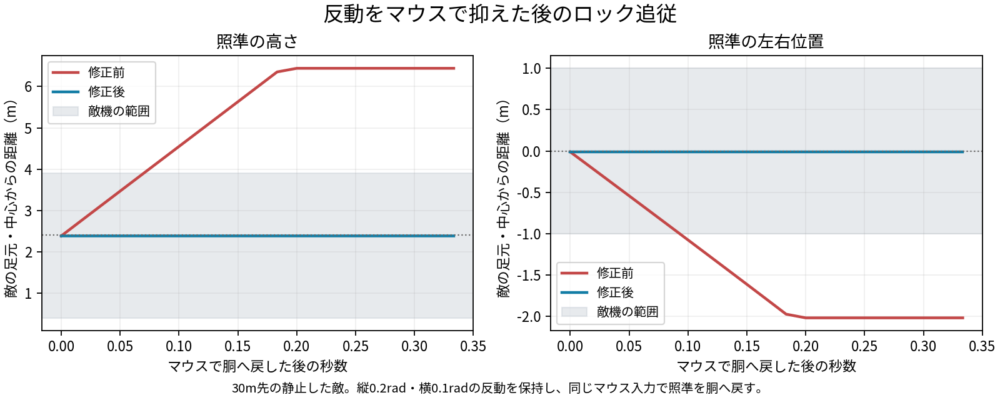

# 反動を抑えた照準とロック追従（2026-10-21）

ユーザー指摘：「反動をマウスで抑えてもロックオンの中心が敵機より上へ行く」「反動で上へずれるのはよいが、ロックオンは敵機へ寄せる」。

## 原因と修正

初回の反動実装では、ロックの引き戻しを反動のない `pitch`・`yaw` から計算していた。マウスで下へ引くと `pitch` が下がる一方、画面の照準は `pitch + recoil` で敵の胴へ戻る。この状態をロック側は「敵より下」と判定し、上へ押し戻していた。横も同じ問題があった。

`lockStick` の縦を `pitch + recoil`、横を `yaw + recoilYaw` に合わせる。発射時の跳ねを残し、敵から外れた照準を既存の毎秒0.8radの範囲で戻す。武器の反動値・回復・精度・弾道、ロックの範囲と速さ、ショートダッシュで振り切る規則は維持する。手で頭へ置いた照準を中心へ寄せず、弾は照準へ飛ぶ。



## 再現と結果

30m先の静止した敵を、標準機体の肩越しカメラで狙う。縦0.2rad、横0/±0.1radの反動を加え、反動と同じ角度だけマウスで抑えて胴へ戻した後、20フレーム（60fps、約0.33秒）操作を止める。ブラウザの `mousemove` → 本体の `playerUpdate` → `updateCamera` を使う。反動の自然減衰と追従を区別するため、この比較では回復待機を10秒に置いて反動を保持する。位置は毎フレーム固定する。照準の高さ・左右位置は、カメラの実際の方向と敵のいる面との交点から求める。

| 横反動 | 高さ：修正前→後 | 左右位置：修正前→後 |
|---|---:|---:|
| 0 | 6.413→2.400m | 0→0m |
| +0.1rad | 6.441→2.384m | −2.018→−0.011m |
| −0.1rad | 6.394→2.416m | +1.984→−0.011m |

敵機とみなす高さは0.4〜3.9m、横は±1m。修正前は胴へ戻した照準が上と横へ押し出され、修正後は胴に保たれた。[修正前の実測](before.json)／[修正後の実測](validation.json)。

- `node tools/test/recoil_lock_check.js dbg/recoil-lock-after media/recoil-lock-control`：22項目成功。反動を抑えた照準、操作しない場合の縦横の引き戻し、実際のマグナム発射時の跳ね、追従速度、頭への照準、半分だけ抑える操作、ショートダッシュ、移動する敵、弾の方向を確認。ブラウザエラーなし。[ログ](check.log)。
- 同じ検査を変更前の `3da64c5` で実行し、上記の問題を含む8項目が失敗することを確認した。これは再現のための意図した失敗。[ログ](before.log)。
- `primary_recoil_check.js`：既存の主武器反動167項目・実射8ケースが成功。ロックの合格条件を今回のユーザー指定へ更新。全286武器・パーツの数値と装備順の互換性も確認。[結果](primary-validation.json)／[ログ](primary-check.log)。
- `node tools/test/quick_check.js origin/main`：武器・パーツ・マップの定義変更なし。city/dock各60秒のBot戦が成功。ブラウザエラーなし。[ログ](quick-check.log)。

## 次へ残す知識

最初の検査は「反動を加えても引き戻しの結果が変わらない」を合格条件としており、手で反動を抑えた後の挙動を検証していなかった。照準に足す角度がある場合は、ロックの判定も画面の照準と同じ角度を使う。今後は「発射で跳ねる」「操作しなければ敵へ戻る」「手で戻した位置を維持する」を組み合わせて検査する。

## 再実行

```sh
python3 tools/test/make_dbg.py dbg/recoil-lock-after
node tools/test/recoil_lock_check.js dbg/recoil-lock-after media/recoil-lock-control
node tools/test/quick_check.js origin/main
```

対象のソースと検査のSHA-256は [source-manifest.json](source-manifest.json) に保持する。図は検査の実測JSONをmatplotlibで描いたもの。
