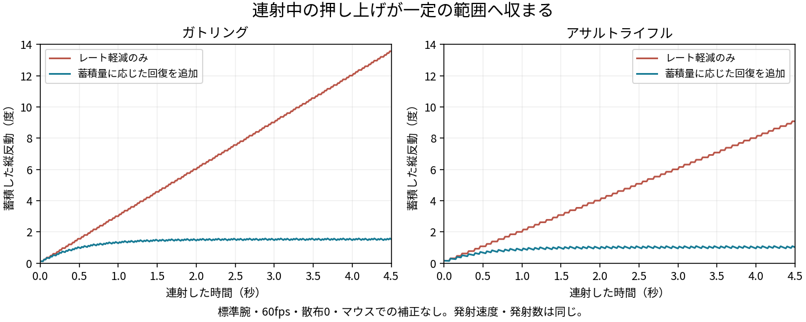

# 蓄積量に応じた反動回復の確認

2026-10-22。比較前は`e0d5365`（600/rpmの軽減済み）。ガトリングは回転済みの状態から4.5秒撃ち、過熱・装填を挟まない区間を比較する。標準腕・散布0・乱数7169・手動の狙い補正なし。カメラとは別の散布を混ぜず、実際の`weaponsTick`・`shot`を通す。

| 武器 | 60fpsでの発射数 | 従来の縦反動ピーク | 比例回復後 |
|---|---|---|---|
| ガトリング | 113→113 | 約13.56° | 約1.58° |
| アサルトライフル | 59→59 | 約9.08° | 約1.09° |
| マグナム | 8→8 | 約9.63° | 約9.63°（経過も一致） |



30/60/144fpsとも同じ発射数を維持。連射銃は3秒以降の蓄積量がほぼ一定で、縦反動ピークのFPS差は約3%以内。発射のフレームへの丸めによる小差と、回復の計算自体の時間刻み依存は区別する。0.5秒間の回復量は3つのFPSで一致する。

`soft_recoil_check.js`は47項目・実射18ケースを確認。待機中の回復、手動の縦横操作の維持、0を越えない復帰、適用対象外の武器、プレイヤー/Bot共通、再出撃時の初期化を含む。計測の要約は`summary.json`。ブラウザエラー0。

```sh
python3 tools/test/make_dbg.py dbg/soft-recoil-before --src /tmp/比較前のindex.html
python3 tools/test/make_dbg.py dbg/soft-recoil
node tools/test/soft_recoil_check.js dbg/soft-recoil dbg/soft-recoil-before /tmp/soft-recoil-results
node tools/test/primary_recoil_check.js dbg/soft-recoil dbg/rate-recoil-before /tmp/primary-recoil-results
node tools/test/camera_recoil_check.js dbg/soft-recoil /tmp/camera-recoil-results
```

`primary_recoil_check.js`の比較前はレート軽減前の`9d39a6a`を使う。194項目・実射8ケースで主武器100種の基準値、既存の装備性能、腕部、レート補正、マグナムの経過、カスタマイズを確認。`camera_recoil_check.js`は531項目で4HUD・8武器・距離/画角、中央固定の照準と射線、連射、入力同期を確認する。

企業の開発解説・参考案と本作の係数の区別は [調査記録](../../research/weapons/fps-recoil-practices.md) を参照。これらは固定条件での機能試験であり、体感の好みや武器間の対戦バランスまで確定する物ではない。
