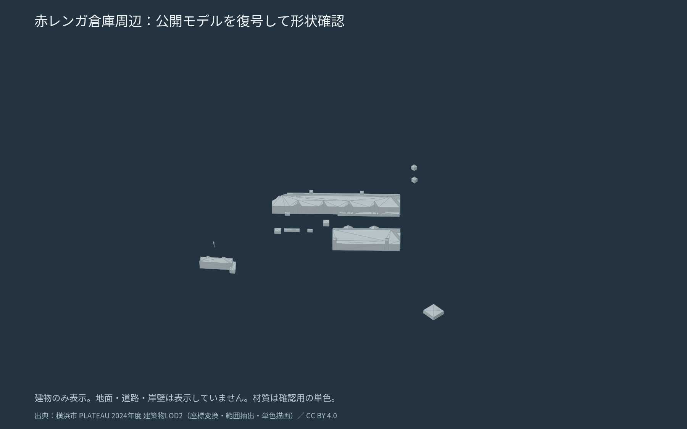

# 梅田・赤レンガ倉庫・秋葉原の収録確認

2026-10-22、都庁周辺の複層構造をユーザーが指摘した後、別の候補地を確認した。ユーザーは梅田を選び、収録状況を確認したうえで赤レンガ倉庫、難しければ秋葉原と指定した。

| 候補 | 実際に確認した内容 | 今回の判断 |
|---|---|---|
| 梅田・大阪駅〜阪急／阪神側 | 大阪市北区2025年度の建物6タイルを取得。大阪駅・大阪梅田駅を含む属性を確認。中心135.4977,34.7024の±350mでは詳細道路・橋梁の末端contentの範囲に重なりがない。地面の標高取得結果は0.4m、ジオイド高37.5980m | 建物が無いわけではない。地上の道路を別途補う必要がある |
| 横浜赤レンガ倉庫 | 横浜市中区2024年度の該当建物2タイルを復号し、倉庫2棟の屋根形状を位置と形で確認。候補中心139.643,35.4527の±500mに詳細道路2件はあるが南側に限られる。交通（広場）LOD3の重なりは0 | 倉庫モデルは利用できる。広場・道路・岸壁を含む完成した地形一式としては取り込めないため、補完する案として残す |
| 秋葉原駅・電気街側 | 千代田区と台東区2025年度の建物・道路・橋梁を組み合わせ、600m四方を実際に復号・表示 | ユーザー指定の代替案として [地形プレビュー](../../../mapdesign/akihabara_city/README.md) を作成 |

赤レンガ倉庫のモデルは存在するため「赤レンガは使えない」とは扱わない。詳細道路が部分的なことと、建物の有無・地面の標高が得られることを分ける。また都市設備LOD3には候補範囲との重なりがあり、個々の岸壁を含む構造物すべてが欠けるとは断定しない。今回の選択は、詳細な地上道路も同時に取り込める秋葉原を先に確認するという制作上の判断。

赤レンガの比較に使ったLOD2とLOD3の2タイルずつは同じSHA-256だった。このサンプルについては配信項目をLOD3に切り替えても細部が増えない。図は2タイルを復号・座標変換し、倉庫付近の三角形745枚を抽出して単色描画した形状確認で、地形プレビューではない。地面・道路・岸壁は表示していない。

## 調査方法と取得記録

公式公開ビューアの公開GraphQLカタログから地域コード27100（大阪市）、14100（横浜市）、13101（千代田区）、13106（台東区）のモデル一覧を取得し、公開3D Tilesの末端contentの範囲を候補の矩形へ照合した。親タイルだけの大きな範囲や、都市モデルが存在することだけでは収録済みと判断しない。実形状への照合と通行検査は別に扱う。

[checked-sources.json](checked-sources.json) に公式配布先・アセットURL・SHA-256・サンプルを保存した。梅田は建物バイナリの取得と属性を、赤レンガは2タイルの復号形状を、秋葉原は全選択タイルの復号・範囲照合・描画まで確認した。比較矩形の大きさが異なるため、タイル数を品質の優劣や網羅率として比較しない。

## 出典・利用条件・謝辞

- [大阪市2025年度モデル](https://www.geospatial.jp/ckan/dataset/plateau-27100-osaka-shi-2025)
- [横浜市2024年度モデル](https://www.geospatial.jp/ckan/dataset/plateau-14100-yokohama-shi-2024)
- [PLATEAUサイトポリシー](https://www.mlit.go.jp/plateau/site-policy/)：公共データ利用規約1.0、CC BY 4.0互換
- 国土地理院の標高・ジオイド高は [コンテンツ利用規約](https://www.gsi.go.jp/kikakuchousei/kikakuchousei40182.html) に従う。秋葉原の詳細な出典はプレビューのCREDITSに記載。

図は横浜市の建築物モデルを加工したものとして、原出典と加工した旨を添え [CC BY 4.0](https://creativecommons.org/licenses/by/4.0/) で利用できる。公開都市モデルを整備された大阪市、横浜市、東京都、千代田区、台東区、国土交通省、国土地理院および制作・開発に携わる皆さまに、心より感謝します。
